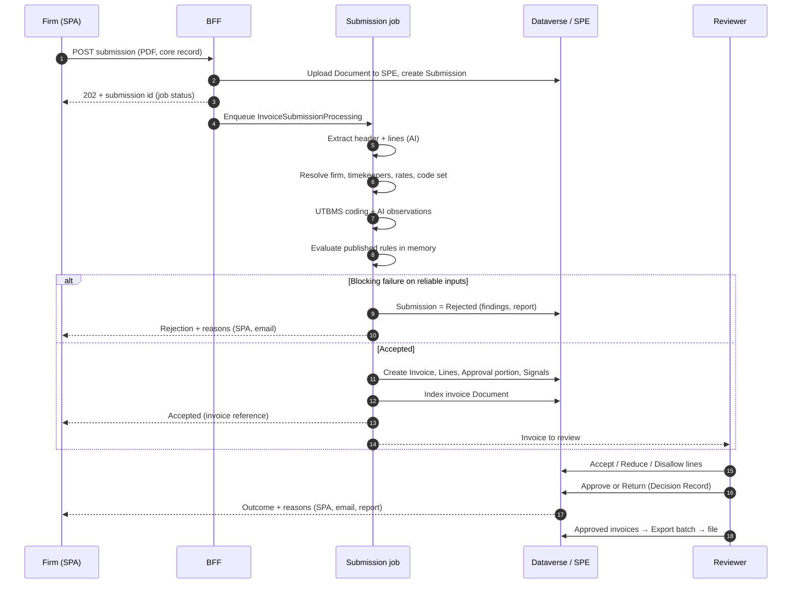

# eBilling R1 — Design

> **Status**: Final draft — ready for `/design-to-spec` · 2026-10-14 (all owner decisions D-01 – D-32 incorporated)
> **Parent Epic**: #1847 (FINANCE, E-BILLING, INVOICING, BUDGETING)
> **Project Type**: Module
> **Portfolio Issue**: #1850 (https://github.com/spaarke-dev/spaarke/issues/1850)
> **Binding constraint**: `.claude/constraints/bff-extensions.md` (CLAUDE.md §10)
> **Inputs**: [notes/decisions-log.md](notes/decisions-log.md) (D-01 – D-30, binding) · [notes/solution-overview.md](notes/solution-overview.md) · [notes/research/](notes/research/)

> **Revision (2026-10-14, design-to-spec interview — D-33 – D-44 supersede the text below where they differ; `spec.md` is authoritative):**
> - **Approvers** come from the multi-select `sprk_billingapproverrole` on each core record; any one eligible approver approves (D-33, D-40) — supersedes "responsible attorney" in §7.6.
> - **Invoice lifecycle** uses OOB `statecode`/`statuscode` (Active: In Review, Approved, Sent to AP; Inactive: Paid, Rejected, Returned to Firm, Cancelled); `sprk_invoicestatus` retired; **no separate payment status** — supersedes §5.1 `sprk_paymentstatus`, §5.4 and invariant I-6 (D-41).
> - **Amounts**: approved total = billed − line adjustments − invoice-level adjustments (percent of fees after line adjustments, or fixed) — refines I-1 (D-42).
> - **Whole-invoice Reject** is final; **Return to Firm** closes the invoice and the resubmission creates a new linked invoice; submissions numbered `{invoice}.{n}` (D-34, D-37, D-43).
> - **Containers**: no record-specific containers exist. Invoice PDFs go to the general container (secure-record container for secure records); guidelines / rate cards / procedures to a **Procedures** container; export files to an **e-billing** container (D-35, D-44) — supersedes "container derived from the core record" in §7.3. The invoice AI Search index is built from structured invoice and line records (D-44).
> - **Firm notifications** go to the submitter and the firm's billing contact (spec Q3 → B). **Volume** ~100–200 submissions per environment per month (D-38).

---

## 1. Summary

eBilling R1 is the first module of Spaarke eBilling. Outside counsel submit PDF invoices through the partner SPA. Spaarke stores each invoice as a Document in SPE, extracts the header and lines with AI, codes every line to UTBMS, and checks the invoice against published billing rules derived from the client's guidelines and rate cards. Hard failures are rejected while the firm is still in the submission session; everything else is accepted, flagged and routed to an in-house reviewer. The reviewer accepts, reduces or disallows lines and approves or returns the invoice. Firms see outcomes and reasons in the SPA and in a report. Approved invoices are exported to AP as a file.

R1 scope is the ten core features agreed in D-10. It closes one complete loop — **submit → check → decide → tell the firm → export for payment** — on one channel, and is designed so that the fast followers (mailbox and Outlook intake, POs, accruals, taxes and EU e-invoicing, multi-matter invoices, auto-adjust) are additions, not restructuring.

### 1.1 Goals

| # | Goal | Measure |
|---|---|---|
| G1 | A firm can submit a PDF invoice and know within the session whether it was accepted | In-session result for a typical invoice (§12) |
| G2 | Guidelines and rate cards become published, citable rules without hand-configuration | An admin publishes a rule set from an uploaded OCG; every rule cites its clause |
| G3 | Reviewers see every line's findings with rule and clause, plus matter context and related work product, and decide per line | Review completed in the review screen without leaving it |
| G4 | Firms are told what was rejected or adjusted and why | Outcome and reasons visible in SPA + report |
| G5 | Approved invoices reach AP | Export file with approved amounts |
| G6 | The Ontology can consume eBilling facts without translation | Signals, Decision Records and invoice facts in the shared shapes (§9) |

### 1.2 Non-goals for R1

LEDES file intake, AP mailbox and Outlook intake, auto-adjust and auto-approve, multi-level approval routing, formal appeals, accruals, POs, GL / cost-centre coding, taxes and multi-currency, AI historical-pattern checks, "no supporting work product" flag, benchmarking, Teams / Copilot surfaces. Each is listed in §14 with how the design accommodates it (accruals D-14; taxes, VAT and EU e-invoicing D-15, D-25; GL and cost centre D-22).

---

## 2. Glossary (binding terminology — D-06)

| Term | Meaning |
|---|---|
| **Invoice** | The header / wrapper record (`sprk_invoice`). The unit of **submission, approval and payment**. Carries billed, adjusted and approved totals. |
| **Invoice Line** | One line of spend (`sprk_billingevent`, displayed as "Invoice Line"). The unit of **spend and review**. Types: Fee (time), Expense, Adjustment (invoice-level discount or credit). |
| **Core record** | The business record a line or invoice belongs to: Matter, Project, Work Assignment, or a future core type (D-28). The **line's** core record is authoritative (D-11). |
| **Submission** | One attempt to submit an invoice (`sprk_invoicesubmission`). Outcome: Accepted (creates the Invoice) or Rejected (never becomes an Invoice). |
| **Analysis** | Automated work after submission: extraction, UTBMS coding, AI observations, rule evaluation. |
| **Finding** | An automated result of analysis on an invoice or line. Persisted as a **Signal** (`sprk_signal`). Always cites rule (policy + version) and clause. |
| **Submission rejection** | The system refuses a submission because a blocking rule failed on reliable inputs (§7.5). |
| **Line review** | A reviewer's outcome per line: **Accept**, **Reduce** (approved amount + reason) or **Disallow** (approved amount 0 + reason). |
| **Approval portion** | The part of an invoice belonging to one core record, approved by that core record's approver (`sprk_invoiceapproval`). R1 invoices have exactly one portion. |
| **Invoice approval** | The decision that the invoice is payable at its approved total. Written as a **Decision Record**. |
| **Return to firm** | A reviewer sends an invoice back for correction; the firm resubmits as a new submission. |
| **Override** | An internal user accepts a submission despite a blocking failure, with a recorded reason (D-24). Written as a Decision Record. |
| **Rule set** | A published group of rules derived from one source (an OCG, a rate-card letter, a procedure). Assigned to firms (§7.2). |
| **Rule** | A typed, versioned, citable condition with a consequence (`sprk_policy` + `sprk_policyversion`, D-23). |
| **Export batch** | A set of approved invoices exported to AP in one file. |

**Invariants**
- I-1: Invoice approved total = Σ line approved amounts + invoice-level adjustment lines.
- I-2: An invoice cannot be approved while any line is in Pending or Flagged.
- I-3: Payment and export are invoice-level only; lines are never paid individually.
- I-4: "Reject" applies to submissions and invoices; lines are "disallowed".
- I-5: An AI judgement finding never rejects a submission on its own (ADR-039 advisory output).
- I-6: Approval status and payment status are separate fields.

---

## 3. Users and surfaces

| Persona | Who | Surface |
|---|---|---|
| Firm submitter | Outside counsel billing staff (Entra External ID / CIAM user) | Partner SPA (`src/client/external-spa`) |
| Billing admin | Legal operations | Model-driven app (firms, timekeepers, rate cards, rule sets) + Rule Review code page |
| Reviewer / approver | In-house attorney responsible for the core record | Invoice Review code page (from the Invoice form and "Invoices to review" view) |
| Internal submitter | Legal ops / AP staff entering a paper or emailed invoice | `CreateInvoiceWizard` code page (D-19) |
| Finance / AP | AP clerk | Export batch form (model-driven) + export file |

---

## 4. End-to-end flow (R1)



---

## 5. Data model

All schema follows the Dataverse write-path rules (one server-side owner per invariant, no plugins — ADR-002) and ADR-024 dual-field polymorphism. Full column lists are settled in the spec; this section fixes the shape.

### 5.1 Extended entities

**`sprk_invoice` (Invoice)** — existing. Already has `sprk_Matter`, `sprk_project`, `sprk_RegardingAgreement` and the ADR-024 resolver fields.

| Change | Purpose |
|---|---|
| Add `sprk_regardingworkassignment` lookup; use the resolver fields as the invoice's **primary core record** | D-28 — not matter-only |
| Add `sprk_submission` (lookup to accepted submission), `sprk_submissionchannel` (SPA, Internal; later Mailbox, Outlook, API) | Provenance |
| Add `sprk_billingperiodstart/end`, `sprk_feestotal`, `sprk_expensestotal`, `sprk_adjustmentstotal`, `sprk_approvedtotal`; keep `sprk_totalamount` as billed total | Totals and I-1 |
| Replace the `sprk_invoicestatus` option set (today ToReview, Reviewed) with the lifecycle in §5.4; migrate the two existing values | Status model |
| Add `sprk_paymentstatus` (Not exported, Exported, Paid later) and `sprk_exportbatch` | I-6 |
| Add `sprk_firmreference` text fields only where promoted from identifiers (§5.3) | Search / duplicate detection |
| Keep `sprk_currency` and `_Base` money fields; validate USD only in R1 (D-20) | Currency later without restructuring |

**`sprk_billingevent` (Invoice Line)** — existing; becomes *the* line entity (D-18). Display name "Invoice Line". Already has `sprk_Invoice`, `sprk_matter`, `sprk_project`, `sprk_linesequence` (alternate key with invoice), amount, quantity, rate, `sprk_costtype`, description, date, timekeeper text and role.

| Change | Purpose |
|---|---|
| Add `sprk_regardingworkassignment` + ADR-024 resolver fields; line core record is authoritative (D-11, D-28) | Multi-matter later; not matter-only |
| Add `sprk_linetype` (Fee, Expense, Adjustment) or extend `sprk_costtype` | Line types |
| Add `sprk_timekeeper` lookup (keep extracted name text as `sprk_timekeepernameasbilled`) | Rate and timekeeper rules |
| Add `sprk_approvedrate`, `sprk_approvedamount`, `sprk_adjustmentreason`, `sprk_reviewedby`, `sprk_reviewedon` | Line review |
| Add `sprk_linestatus` (§5.4) | Review state; separate from the overloaded `sprk_visibilitystate` |
| Add UTBMS lookups `sprk_taskcode`, `sprk_activitycode`, `sprk_expensecode` (AI-assigned) and text `sprk_*codeasbilled` (firm-supplied) + `sprk_codingconfidence` | D-05 |
| Add `sprk_extractionconfidence` (JSON: per-field confidence + source page) | Reliable-input rule (§7.5) |
| Reserved for fast followers (nullable, not built in R1): PO lookup, GL account / cost centre lookups, tax lines relationship | §14 |

`sprk_invoicelineitem` is retired (removed from the solution after confirming no data or references).

**`sprk_signal`** (Ontology-owned; changes coordinated — D-28, D-30)

| Change | Purpose |
|---|---|
| Add `sprk_regardinginvoiceline` lookup (to `sprk_billingevent`); dedupe key per line | Gap 1: line-level subject |
| Core-record derivation for invoice and line subjects covers all core types (matter, project, work assignment, …), writing `sprk_corerecordtype` / `sprk_corerecordid` | Gap 2: not matter-only |
| Add firm-visible reason text (rendered by the describer, no internal-only facts) | Firm feedback |

**`sprk_decisionrecord`** (Ontology-owned) — add `sprk_regardinginvoiceline` for parity; invoice gates use the existing `sprk_regardinginvoice`.

**`sprk_policy` / `sprk_policyversion`** (Ontology-owned, shared store — D-23) — add `sprk_domain` (Billing, Ontology, later Docketing — D-26), `sprk_ruleset` lookup, `sprk_clausereference` (quote + location in the source document), `sprk_consequence`.

### 5.2 New entities

| Entity | Purpose | Key fields |
|---|---|---|
| `sprk_invoicesubmission` | Every submission attempt, including rejected ones | channel, submitter, firm, core record (ADR-024), document, received on, processing status, outcome, rejection reasons (findings JSON), report document, resulting invoice, resubmission of |
| `sprk_timekeeper` | Firm timekeepers | firm, name, classification (UTBMS/LEDES timekeeper class), status (Approved, Pending, Inactive), effective from/to, linked external contact (for work-product matching, D-08) |
| `sprk_ratecard` + `sprk_ratecardrate` | Approved rates with provenance | card: firm, optional core-record scope, source document, status, effective from/to · rate: timekeeper or classification, approved rate, rack rate, effective from/to |
| `sprk_billingcode` | UTBMS code tables | code set (Litigation, Counseling, Project, Bankruptcy, …, Activity, Expense), code, phase, description, code-set version, status |
| `sprk_ruleset` | Domain-agnostic group of rules from one source (D-26) | domain, name, source document, scope (client default / firm), status, effective from/to |
| `sprk_invoiceapproval` | Approval portion: invoice × core record | invoice, core record (ADR-024), approver, status, approved amount, decision record |
| `sprk_externalidentifier` | Typed identifiers on invoice (later matter, firm) — D-12 | regarding (ADR-024), identifier type, value, issuing organization / system |
| `sprk_billingexport` | Export batch | created by/on, invoice count, total, format, file document, status |

Reference data (rate cards, timekeepers, code sets) is **data, not rules** (D-23): rules reference it by type; rule bodies never copy rates.

### 5.3 Identifiers (D-12)

Identifier types in R1: firm invoice number, firm client-matter number, law-department matter number, PO number as quoted. Reserved: AP document number, VAT invoice number, e-invoice / clearance ID, Peppol message ID (D-25). The firm invoice number is also promoted to `sprk_invoicenumber` for duplicate detection. A firm's own matter number is stored as an identifier on the core record with the firm as issuer — this is how a firm-quoted number resolves to a core record (needed for the mailbox in R2).

### 5.4 Status models

| Record | States |
|---|---|
| Submission | Received → Processing → Accepted · Rejected · Failed (system error, retryable) |
| Invoice | In Review → Approved · Returned to Firm · Cancelled; then payment status Not Exported → Exported (→ Paid, R2) |
| Invoice Line | Pending → Clean · Flagged → Accepted · Reduced · Disallowed |
| Approval portion | Pending → Approved · Returned |

Clean lines are accepted by default when the reviewer approves (I-2 still holds: no line may remain Flagged).

### 5.5 Relationship to core records and access

Invoices and lines are children of core records. Server writes stamp the core ancestor through `CoreAncestorResolver` so unified access control (ADR-034, child inheritance) works for internal users and the external SPA. External visibility today keys on `sprk_invoice.sprk_project`; R1 extends it to every core type the firm can access, and to **only the firm's own invoices**.

---

## 6. Rules platform (D-23, D-26, D-27)

One rules **system**, with evaluation strategies per workload, decided from first principles (D-16). Analysis: [notes/research/rule-engine-first-principles.md](notes/research/rule-engine-first-principles.md).

| Layer | Shared | eBilling-specific |
|---|---|---|
| Rule types | Closed `RuleType` set grouped by domain; one JSON Schema and one describer entry per type; a new type is a reviewed code change, never configuration | Billing types (§6.1) |
| Authoring and validation | `PolicyVersionValidator` (single fail-closed seam); AI proposes, a person approves the compiled form | OCG → rules drafting action (§7.2) |
| Store | `sprk_policy` / `sprk_policyversion`, immutable versions, effective dates, citation | `sprk_ruleset` grouping, clause reference |
| Fact assembly | — | In-memory fact set for one invoice: lines, timekeepers, rate cards, code tables, core-record dates, prior invoices for duplicates |
| Evaluation | — | `InvoiceComplianceEvaluator` (in-memory strategy) |
| Consequences | Closed consequence catalogue (`DecisionActionCatalog`) | Reject submission, Flag, Suggest adjustment; (R2) Auto-adjust |
| Outputs | `SignalWriter`, Decision Records | Line-level subject, firm-visible reasons |

The Ontology keeps its FetchXML push-down strategy unchanged. A future domain (e.g. IP docketing: trigger event → calculated due dates → tasks) adds its own rule types and its own strategy behind the same validator, store and outputs. No Power Fx or other low-code language (D-27). No new packages, and no licensed or fee-bearing dependencies (D-29).

**Dependency (D-30):** eBilling uses `RuleType`, `RuleBodySchemaValidator`, `PolicyVersionValidator`, `RuleBodyDescriber`, `SignalWriter`, `DecisionActionCatalog` / `DecisionPlanService` and the Decision Record writer from Ontology PR #1111 (`docs/ontology-platform-design`). It must be on master before the first evaluator task; until then eBilling co-builds from that branch, never copies.

### 6.1 Billing rule catalogue (R1)

| # | Rule type | Checks | Parameters | Reference data | Allowed consequences |
|---|---|---|---|---|---|
| 1 | ApprovedTimekeeper | Line timekeeper is approved for the firm (and core record) on the line date | — | Timekeepers | Reject, Flag |
| 2 | ApprovedRate | Billed rate ≤ approved rate for timekeeper or classification on the line date | tolerance | Rate cards | Reject, Flag + suggested adjustment |
| 3 | TimeIncrement | Hours are a multiple of the increment | increment (e.g. 0.1) | — | Flag |
| 4 | DailyHoursCap | Hours per timekeeper per day ≤ cap (within the invoice in R1) | cap | — | Flag |
| 5 | NonBillableActivity | Line's activity / task code (AI-assigned) is not billable | code list | Code tables | Flag + suggested disallow |
| 6 | ExpenseRule | Expense code not reimbursable, or amount over cap per item | code list, cap | Code tables | Reject, Flag |
| 7 | InvoiceAge | Line date older than N days before invoice date | days | — | Reject, Flag |
| 8 | CoreRecordWindow | Line date outside the core record's open/close dates, or core record closed | grace days | Core record | Reject, Flag |
| 9 | Duplicate | Invoice number already submitted by the firm; duplicate lines (timekeeper, date, hours, narrative) | match fields | Prior invoices | Reject (invoice), Flag (line) |
| 10 | RequiredData | Required header or line data present (e.g. billing period, task code where the core record's code set requires it) | field list | — | Reject, Flag |
| 11 | AiObservation | AI observation present with confidence ≥ threshold: block billing, vague description | observation, threshold | — | **Flag only** (I-5) |

The billing admin chooses the consequence per rule from the allowed list. Rule types 1, 2, 6–10 may reject; 3–5 and 11 may not.

---

## 7. Functional design

### 7.1 Setup and reference data

- **Firms**: `sprk_organization` (type Law Firm), linked to core records through existing engagement / access grants; firm users invited to the SPA through the existing invite-and-grant flow.
- **Timekeepers**: admin-managed in R1 (manual entry and spreadsheet import with the rate card). Firm-proposed timekeepers and rate-increase requests are R2.
- **Rate cards**: spreadsheet import (template provided) and manual entry; each card keeps its source document. Draft → Published.
- **UTBMS code tables**: seeded per code-set version (UTBMS and LEDES standards are freely usable by systems — D-32). Each core-record type (or practice area) maps to a task code set.

### 7.2 Guidelines → rules

1. Admin uploads an OCG / procedure / rate letter as a Document (SPE) and creates a rule set (domain Billing, scope client default or a firm).
2. A JPS analysis action ("Draft billing rules") reads the document and proposes rules **only from the §6.1 catalogue**, each with parameters, consequence, and the clause quote + location. Output is schema-validated against the rule-type schemas (ADR-039 closed catalogue); unsupported guideline text is listed as "not converted", never forced into a rule.
3. The Rule Review page shows each proposed rule beside its clause; the admin edits, rejects or accepts each.
4. Publishing runs `PolicyVersionValidator`; published versions are immutable with an effective date. A changed rule is a new version.
5. Precedence when both a client default set and a firm set contain the same rule type: the firm set wins (confirmed in spec).

### 7.3 Submission

- **SPA**: Invoices widget gains "Submit invoice": choose a core record from those the user can access, upload one PDF, optionally enter firm invoice number and PO number. The SPA shows progress (job status, ADR-017) and then the result: accepted (invoice reference) or rejected (reasons + downloadable report). The user can leave; the result also arrives by SPA notification and email.
- **Internal** (D-19, D-24): `CreateInvoiceWizard` is rewired to the same server-side submission operation and shares components with the SPA through `@spaarke/ui-components`. The internal user also selects the firm. A blocking failure is shown with two choices: **Override** (reason required → Decision Record) or **Return to firm**.
- One server-side operation owns submission: upload Document to SPE (container derived from the core record), create `sprk_invoicesubmission`, enqueue `InvoiceSubmissionProcessing`. No client creates invoices directly.

### 7.4 Extraction and coding

- Extends the existing Finance extraction (`InvoiceAnalysisService`, `FinanceJsonSchemas`) — no new extraction pipeline. SPA and internal submissions skip the attachment-classification step (the submitter declares it is an invoice); classification stays for the R2 mailbox.
- Header: firm, firm invoice number, invoice date, billing period, firm matter reference, PO as quoted, fees / expenses / adjustments / total due, currency.
- Lines: date, timekeeper as billed, title / classification as billed, hours, rate, amount, narrative, codes as billed, line type.
- Per-field confidence and source page are kept (`sprk_extractionconfidence`).
- **UTBMS coding** (D-05): a second structured-output step assigns task, activity and expense codes per line from the closed code tables (enum-restricted output), with confidence. Firm-supplied codes are kept; a mismatch is a finding.
- **AI observations**: block billing and vague description, each with confidence and the quoted text. Facts only; the policy decides (Ontology §4.12 "LLM does perception, policy does judgment").
- Whether Azure AI Document Intelligence (layout / invoice model) improves line-table extraction over the current text + LLM approach is an early spike (§13 WP0).

### 7.5 Evaluation and the rejection rule

The evaluator runs all rules in force on each line's date for the line's core record and firm. A submission is **rejected** only if:
1. a rule whose consequence is Reject fails, **and**
2. every field that rule read was extracted with confidence ≥ the reliability threshold (configurable; default set in spec), **and**
3. the rule type is reject-eligible (§6.1; never AiObservation).

Otherwise the submission is accepted and the failure becomes a Flag for the reviewer, who can correct misread values. The rejection report shows the values read ("Line 14: timekeeper J. Smith, rate $650 — approved rate $575 from 1 Jan 2026, Guideline §4.2").

### 7.6 Review and approval

- **Invoice Review** code page: header and totals; lines grid with status, findings (rule, version, clause), suggested adjustment; per-line Accept / Reduce / Disallow with reason; bulk accept of clean lines; correction of misread extracted values (audited).
- **Context panel** (D-07, deterministic): core record status and dates, budget vs spend (existing Finance rollups), prior invoices from this firm on this core record, this firm's disallow history, timekeeper rate history. Matter report card from the Ontology Insights engine when available.
- **Related work product panel** (D-08, on demand per line): documents on the line's core record within the line's date window, authored by the line's timekeeper (via timekeeper ↔ external contact), ranked by semantic similarity of the narrative using the files index filtered to the core record. Read-only.
- **Approval**: one approval portion per core record (R1: one per invoice). Approver resolved from the core record's responsible attorney (field confirmed in spec). Approve requires I-2; writes a Decision Record and sets approved totals (I-1). Return to firm requires a reason; writes a Decision Record.

### 7.7 Firm feedback

- Feedback to firms is limited to rejections and adjustments; firms are never asked to validate extracted data (D-09). and every Reduced / Disallowed line with reason and clause. Internal flags are not shown before a decision.
- Email (shared mailbox via `CommunicationService`) and SPA notification feed (notification spine, ADR-047) on rejection, return, and approval with adjustments.
- **Adjustment report** document per rejection or decided invoice, downloadable in the SPA and attached to the email (format confirmed in spec).

### 7.8 AP export (D-21)

- Finance user creates an export batch from approved, not-yet-exported invoices.
- File in CSV and JSON from a configurable field mapping (not hard-coded columns); stored as a Document; batch record holds totals and the file.
- Exported invoices move to payment status Exported (prevents double payment). Coding columns (GL, cost centre, PO) are added to the mapping when those fast followers land.

### 7.9 Document and index

The invoice PDF is a `sprk_document` (type Invoice) linked to the submission and, on acceptance, to the invoice. Accepted invoices are indexed into `spaarke-invoices-index` via the existing `InvoiceIndexingJobHandler` (the index is schema-only today — proving it is in scope). Rejected submissions are not indexed into the invoice index.

---

## 8. Architecture

| Component | Location | New / extended |
|---|---|---|
| Submission endpoints (external + internal) | BFF `Api/Finance/` (or `Api/EBilling/`) with endpoint-filter auth (ADR-008) | New endpoints |
| `InvoiceSubmissionService` | BFF `Services/Finance/` | New |
| `InvoiceSubmissionProcessingJobHandler` | BFF `Services/Jobs/Handlers/` (ADR-004) | New |
| Extraction + coding | `InvoiceAnalysisService` + schemas; AI via `Services/Ai/PublicContracts/IInvoiceAi` facade | Extended |
| `InvoiceComplianceEvaluator` + billing rule handlers | BFF `Services/Signals/` namespace (shared with Ontology) | New |
| Rule drafting | JPS analysis action + `IJobHandler` | New action |
| Review, approval, override, export endpoints | BFF | New endpoints |
| SPA submit + invoice detail | `src/client/external-spa` | Extended |
| Invoice Review, Rule Review pages | Code pages under `src/solutions/` | New |
| `CreateInvoiceWizard` | `src/solutions/CreateInvoiceWizard` + shared component | Rewired |
| Schema | `src/dataverse/solutions/SpaarkeMaster` | §5 |

### 8.1 Placement Justification (bff-extensions.md §A, ADR-052)

| Component | Decision | Signals |
|---|---|---|
| Submission endpoints | BFF | B1 (caller identity; user-attributed SPE upload), B4 (live request); ADR-052 forbids user-facing endpoints in Functions |
| Submission processing job | BFF `IJobHandler` | B2 (uses Finance AI services, Signals code, Dataverse services), B3 (low volume). F2 (month-end bursts) is absorbed by the Service Bus queue; revisit if volumes exceed the §12 assumption. Tie-breaker: fewer moving parts |
| Rule drafting job | BFF `IJobHandler` | B2, B3 |
| Review / approval / export endpoints | BFF | B1, B4 |
| Notifications | Existing spine | Reuse |

- **Size impact**: no new packages; code only. Estimated compressed publish delta < 1 MB (measured per task against a fresh master build).
- **Boundary preservation**: AI reached only through the `PublicContracts` facade (`IInvoiceAi`, extended); DI through the existing Finance feature module (`AddFinanceModule`), not `Program.cs` sprawl; endpoint-filter authorization on every route; no new direct CRUD→AI dependencies.

### 8.2 Hot-path declaration

```xml
<hot-path-declaration>
  <bff-api>YES — new endpoints (submission, review, approval, export, rule drafting) and job handlers in the Finance module; InvoiceComplianceEvaluator and billing rule types in Services/Signals (shared with ontology-r1, PR #1111); extended InvoiceAnalysisService / IInvoiceAi facade; FinanceModule DI registrations</bff-api>
  <spaarke-ai>NO — no Console changes in R1</spaarke-ai>
  <ci-workflows>NO</ci-workflows>
  <skill-directives>NO</skill-directives>
  <root-CLAUDE-md>NO</root-CLAUDE-md>
</hot-path-declaration>
```

### 8.3 New components — CLAUDE.md §11 three questions

| Component | Existing overlap | Why not extend | Cost of doing nothing |
|---|---|---|---|
| `sprk_invoicesubmission` | `sprk_invoice` status | Rejected attempts would become invoices and pollute rollups and Ontology facts | Rejections and resubmissions have no audit trail |
| `sprk_timekeeper` | Timekeeper text on the line | Text cannot carry approval status, classification or effective dates | Rules 1–2 cannot run |
| `sprk_ratecard` / `sprk_ratecardrate` | None | — | Rule 2 cannot run |
| `sprk_billingcode` | None | — | AI coding has no closed list (D-05) |
| `sprk_ruleset` | `sprk_policy` category / scope | A policy is one rule; a guideline publishes, scopes and cites as a group | An OCG cannot be published or assigned as a unit |
| `sprk_invoiceapproval` | Decision Record gate fields | Decision Records are append-only history, not workflow state | Multi-matter approval later needs restructuring (D-11) |
| `sprk_externalidentifier` | Single `sprk_invoicenumber` | Many typed identifiers per record (D-12) | Firm / law-department / finance / VAT numbers cannot be tracked |
| `sprk_billingexport` | None | — | No record of what was sent to AP; double payment risk |
| `InvoiceSubmissionService` + job | `InvoiceReviewService` (classification gate) | Different trigger and outcome; reuses its extraction path | No server-side owner for submission |
| `InvoiceComplianceEvaluator` | Finance `SignalEvaluationService` (budget thresholds), Ontology evaluator (FetchXML) | Neither evaluates an invoice in hand (§6) | No rule evaluation at submission |
| Rule-drafting action | NDA review playbook (advisory) | Needs closed-schema rule output, not a risk summary | Admins hand-configure every rule |
| Submission / review / approval / export endpoints | `/api/finance/invoice-review/*` | Different operations; same module | No API for the surfaces |

---

## 9. Ontology coordination contract (D-02, D-03, D-30)

eBilling is upstream: the Ontology picks up from "the invoice is in the system". Agreed or to agree with ontology-r1:

1. **Shared rules system** per §6; eBilling adds billing rule types, schemas, describer entries and catalogue actions through review.
2. **Signal schema**: line-level subject and all-core-type derivation (§5.1) — owner of each change agreed with ontology-r1.
3. **Line entity**: `sprk_billingevent`; `matter.invoicedToDate` and similar rollups sum by the **line's** core record.
4. **Field vocabulary**: invoice and line fields (UTBMS codes, timekeeper class, hours, rates, approved amounts, observations) registered so Ontology policies may reference them (Ontology closed-vocabulary rule).
5. **Insights**: eBilling consumes the matter report card for the context panel and supplies invoice facts (existing `InvoiceLiveFactResolver`).
6. **Merge order**: PR #1111 on master before eBilling's first evaluator task.

**Agreed with ontology-r1 (2026-10-14).** eBilling **owns and builds** items 1–4 as PRs into master after #1111. Ontology reviews the Signal, Decision Record and rule parts; uac-r2 reviews anything touching ownership or lineage. Conditions:

| Item | Condition |
|---|---|
| Line subject on `sprk_signal` / `sprk_decisionrecord` | Schema change approved by the owner (D-31); must be in the solution source (`Entities/sprk_Signal|sprk_DecisionRecord/Entity.xml`, guarded by `SignalPairTypeSchemaAgreementTests`). Both are secure-family tables: register the new lookup with uac-r2's `SecureChildLineage` and the census ArchTests. Extend `SignalWriter.RegardingLookupByEntity` through the shared `TodoRegardingBuilder` / `sprk_recordtype_ref` catalogue, not a hard-coded map. Per-line dedupe key allowed; existing keys unchanged. |
| Invoice → core-record derivation | Use the generic `sprk_corerecordtype` + `sprk_corerecordid` pair for every core type; the stamp follows the **subject**, not the core. `CoreAncestorResolver` and its taxonomy are uac-r2's — their review required. `VerifiedMatterDerivation` reviewed by ontology. |
| Billing rule types | Closed set; each type a reviewed code change with schema, describer entry and validator handling; no data-driven registry. **Every rule-body consumer must refuse a type it cannot evaluate, fail-closed** — the Ontology `PredicateCompiler` / evaluator must refuse billing types it will see in the shared store, and the describer and save-time validation likewise. Copy the null-test pattern from ontology task 061 (PR #1869). |
| Billing actions in `DecisionActionCatalog` | Each action code has a `PlanLane` (the Decision Record writer derives the record class from it). Every billing decision, human or not, uses the additive writer entry `WriteBillingDecisionAsync` (idempotent by decision id; null confirmer only for an `automated:` decider). Amended 2026-10-17 by D-100 (§6.5 path B, ontology-r1 technical agreement): `WriteAsync` needs a policy version and Signals a clean decision does not have, and `WriteGateDecisionAsync` is communication-only. |

Not the Ontology's: `matter.invoicedToDate` by line core record is eBilling's / Finance's to keep correct. Ontology DI-69 (#1663) found dev's matter finance rollups stale or inconsistent — checked in WP0.

---

## 10. ADR alignment

| ADR | How R1 complies |
|---|---|
| ADR-002 | No plugins; server-side owner for submission, invoice creation and approval |
| ADR-004 / ADR-036 / ADR-052 | Queue work as `IJobHandler`; no timers; placement in §8.1 |
| ADR-008 / ADR-003 / ADR-028 | Endpoint filters; CIAM users limited to their firm and accessible core records |
| ADR-013 | AI through `PublicContracts` facade |
| ADR-015 | Invoice narratives may be privileged; Signals and Decision Records carry `privilegeflagged` |
| ADR-017 | Job status for in-session progress |
| ADR-018 / ADR-032 | eBilling behind its own kill switch, `EbillingOptions.Enabled` (default off), with null-object fallbacks. A new flag is justified (ADR-018 rule 2): it kills invoice submission, extraction, review and AP export, while the existing Finance routes (classification review, rollups) must keep working with eBilling off. No existing flag gates the Finance route family; `DocumentIntelligence:Enabled` and `Analysis:Enabled` gate individual AI services only (task 040) |
| ADR-024 | Dual-field core-record relationships on invoice, line, submission, approval portion, identifier |
| ADR-034 | Core-ancestor stamping for child-inheritance access |
| ADR-038 | Tests per the testing strategy; evaluation sets in §13 |
| ADR-039 | Rule drafting and coding output closed, schema-validated; AI findings advisory only (I-5) |
| ADR-047 | Notifications through the spine |
| ADR-012 / ADR-021 | Shared components and Fluent v9 for SPA and wizard |

**ADR tensions**: one project exception recorded after design: the Content Understanding preview analyzer is primary under a path-A exception (D-81, spec.md ADR Tensions), with a GA fallback kept in step. Otherwise none identified at design time. Re-checked at spec (`/adr-check`). The domain grouping of rule types (D-26) needs a matching note in the Ontology design (CM-7/CM-8), coordinated, not an ADR change.

---

## 11. Security

- Firm users submit only as their own firm and only against core records they can access; they see only their firm's submissions and invoices.
- Firm-visible text is rendered only from facts about the firm's own invoice (describer output), never internal notes.
- Override (D-24) requires a reason and is restricted to a security role; every override is a Decision Record.
- Rule publishing restricted to the billing-admin role.
- No new secrets; email sending uses the existing shared-mailbox configuration.

---

## 12. Non-functional requirements (targets to confirm in spec)

| Area | Target |
|---|---|
| In-session result | p90 ≤ 2 minutes for invoices ≤ 20 pages / ≤ 150 lines; the user may leave and is notified |
| Volume assumption | Up to ~2,000 submissions per tenant per month, month-end peaks ×5 (to confirm) |
| Extraction accuracy | Header fields ≥ 95%; line fields (date, timekeeper, hours, rate, amount) ≥ 90% on the evaluation set |
| UTBMS coding | Task code top-1 ≥ 80% on the evaluation set; confidence calibrated so low-confidence codes are flagged |
| Rejection precision | Zero rejections caused by misread values on the evaluation set (enforced by §7.5) |
| Idempotency | Submission processing idempotent per submission id |
| Audit | Every line change, override, approval and return attributable and timestamped |

---

## 13. Delivery plan (work packages for `/project-pipeline`)

| WP | Content |
|---|---|
| WP0 Baseline | Run the existing Finance extraction end to end in dev; check dev matter finance rollups (ontology DI-69, #1663); assemble the evaluation set from public sources (D-17): fee applications, synthetic invoices, real invoices, OCGs, rate cards — `research/test-data-sources.md`); Document Intelligence spike |
| WP1 Data model | §5 schema, seed code tables, admin forms and views, retire `sprk_invoicelineitem`, migrate `sprk_invoicestatus` |
| WP2 Submission | Submission operation, endpoints, SPA submit and result, wizard rewire, extraction and coding extensions |
| WP3 Rules | Billing rule types + schemas + describer on the shared Signals code; evaluator; rule sets; drafting action; Rule Review page |
| WP4 Review | Invoice Review page, line actions, context and related-work panels, approval portions, Decision Records, override, return |
| WP5 Feedback | SPA invoice detail, email and notifications, adjustment report |
| WP6 Export and index | Export batch and file; invoice index proven end to end |
| WP7 Evaluation | Accuracy measurement against §12; tuning; UAT |

Ordering: WP0 → WP1 → WP2 ∥ WP3 (WP3 evaluator after PR #1111 merges) → WP4 → WP5 ∥ WP6 → WP7.

---

## 14. Fast followers and how R1 accommodates them

| Fast follower | Accommodated by |
|---|---|
| AP mailbox (`ap@`) and Outlook add-in intake | One submission operation; channel field; identifier-based core-record resolution; existing classification step |
| LEDES file upload | Canonical model uses LEDES field meanings (D-04); new parser maps into the same model |
| Multi-matter invoices | Line core record authoritative; approval portions (D-11) |
| Auto-adjust / auto-approve | Consequence catalogue gains Auto-adjust; suggested adjustments already computed |
| Multi-level approval | Approval portion + ontology DelegationLimit rules |
| AI historical-pattern checks; "no supporting work product" flag | New AiObservation inputs; context panel facts |
| POs, GL, cost centre (D-13, D-22) | Reserved nullable lookups on invoice and line; PO number as quoted kept separately; configurable export mapping |
| Accruals (D-14) | Keyed by period × firm × core record; reuse coding and export batch |
| Taxes, VAT, multi-currency (D-15) | Currency and base fields present; tax lines as a child of invoice and line; tax identifiers in `sprk_externalidentifier` |
| EU e-invoicing (D-25) | R1 stores the legal e-invoice references; later ingest EN 16931 e-invoices from ERP/Peppol and reconcile to the submission |
| Payment status from AP | `sprk_paymentstatus` separate from approval; append-only feedback table later |
| Firm-proposed timekeepers and rate increases | Timekeeper status Pending; rate card versions |

---

## 15. Dependencies and prerequisites

| Item | Owner | Needed by |
|---|---|---|
| Ontology PR #1111 on master (Signals code) | ontology-r1 | First evaluator task (WP3) |
| Signal schema changes, core-record derivation, billing rule types and actions (§5.1, §9) | eBilling builds; ontology-r1 + uac-r2 review | WP1 (schema), WP3 (rules, actions) |
| Owner approval of the `sprk_signal` / `sprk_decisionrecord` schema change | Owner — **approved (D-31)** | — |
| UTBMS / LEDES usage rights | Owner — **confirmed freely usable (D-32)** | — |
| Evaluation material | Project (public sources) + any design-partner invoices | WP0 |

## 16. Open questions for the spec

1. Which core-record field identifies the approver (responsible attorney, billing approver)?
2. Rule-set precedence beyond "firm set overrides client default for the same rule type"?
3. Where do export files and rule-set source documents live (tenant-level SPE container)?
4. Adjustment report format (PDF vs HTML) and existing document-generation capability to reuse.
5. Volume and SLA assumptions (§12).
6. Resubmission after rejection: same firm invoice number allowed; linked via "resubmission of"?
7. Who may override (role) and whether override needs a second person.
8. Fate of `sprk_billingevent.sprk_visibilitystate` once `sprk_linestatus` and payment status exist.
9. Reliability threshold default for the rejection rule (§7.5).

## 17. Next step

Owner review of this design → `/design-to-spec projects/ebilling-r1` → `/project-pipeline`.
