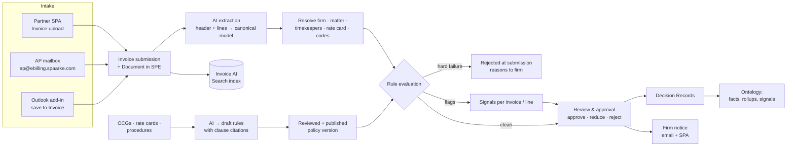

# eBilling — Solution Overview

> **Status:** Draft for discussion · 2026-10-14
> **Project:** ebilling-r1 · Issue [#1850](https://github.com/spaarke-dev/spaarke/issues/1850) · Epic [#1847](https://github.com/spaarke-dev/spaarke/issues/1847)
> **Purpose:** One place for the problem, the market, what Spaarke already has, how the pieces fit, the Ontology coordination points, and a proposed MVP / R2 / R3 cut. It feeds `design.md`; it is not the design.

> **Revision note (2026-10-14, after owner review).** Where this draft and [decisions-log.md](decisions-log.md) disagree, the decisions log wins. Corrections:
> - **§3 Finance pipeline** is built (on master since Feb 2026, still maintained) but **never proven end to end**: dev Dataverse holds 10 hand-made test invoices and 1 line item; the email trigger is gone.
> - **§5 Ontology**: eBilling is *upstream* — the Ontology picks up from "the invoice is in the system". Decision 21 is not a conflict (D-03).
> - **§4.2 LEDES**: the file format is not required; LEDES is a data dictionary only (D-04). UTBMS codes are tables; AI codes each line (D-05).
> - **§4.4 / §5.2 Rule engine**: superseded by [research/rule-engine-first-principles.md](research/rule-engine-first-principles.md) — one rules *system* (shared rule types, validator, policy store, outputs) with two evaluation strategies (Ontology: FetchXML detection; eBilling: in-memory invoice evaluator).
> - **§6 Line items**: extend `sprk_billingevent` (D-18); the line's matter is authoritative (D-11).
> - **§7–8**: MVP scope and the open decisions are settled in the decisions log (D-01 – D-22). Added research: [accruals-po-ap.md](research/accruals-po-ap.md), [tax-vat-einvoicing.md](research/tax-vat-einvoicing.md), [test-data-sources.md](research/test-data-sources.md).

**Sources behind this document** (all in `notes/`):

| File | What it holds |
|---|---|
| [owner-requirements-2026-10-14.md](owner-requirements-2026-10-14.md) | The requirements as stated |
| [research/market-landscape.md](research/market-landscape.md) | Competitor review, 12 vendors, sourced and dated |
| [research/ledes-utbms-ocg-reference.md](research/ledes-utbms-ocg-reference.md) | LEDES formats, UTBMS code sets, OCG rule categories, rate cards, PDF realities |
| [research/repo-state-ingestion.md](research/repo-state-ingestion.md) | What exists for SPA, email, Outlook, documents, search, notifications, jobs |
| [research/repo-state-data-ai.md](research/repo-state-data-ai.md) | What exists for Dataverse schema, finance AI, Ontology, Decisions, rules, approvals |

---

## 1. What we are building

The first module of Spaarke eBilling: outside counsel submit invoices; Spaarke stores each invoice as a Document in SPE, extracts header and line-item data into Dataverse, checks it against the client's billing guidelines and rate cards, flags what does not comply, and lets in-house users approve, reduce or reject invoices and lines. Firms learn about non-compliance immediately (at submission in the partner SPA) or by email and SPA notification.

The parts, from the owner requirements:

1. **Intake.** PDF now; XML/JSON later. Three channels: partner SPA Invoice tab, the `ap@ebilling.spaarke.com` mailbox, and Outlook add-in save. MVP may start with one.
2. **Document and index.** Each invoice is a Document in SPE, indexed in its own AI Search index.
3. **Extraction.** AI extracts into the Invoice and Invoice Line Item records. LEDES and UTBMS codes are supported.
4. **Guidelines and rate cards.** Upload Outside Counsel Guidelines (OCGs), rate cards and procedures; AI converts them into rules.
5. **Compliance.** Invoices and lines are checked against those rules. Non-compliance becomes a Decision, and the firm is told (email + SPA), with reports.
6. **Approval.** Dataverse users approve invoices and line items.
7. **Ontology.** This flows into the Ontology project and must be coordinated with it.

---

## 2. Market context (as of 2026-10-14)

Full detail and sources: [research/market-landscape.md](research/market-landscape.md).

### 2.1 Who is in the market

The enterprise market consolidated in 2025. Five groups own almost every enterprise seat:

| Group | Products |
|---|---|
| Thomson Reuters | Legal Tracker (+ Advanced, CoCounsel AI) |
| Wolters Kluwer ELM Solutions | Passport, TyMetrix 360, LegalVIEW BillAnalyzer, **Brightflag** (acquired June 2025, ~€425M) |
| LexisNexis | CounselLink / CounselLink+ |
| Mitratech | TeamConnect, Collaborati portal, ARIES AI, Managed Bill Review (ex-Quovant) |
| Onit | Unity e-Billing, Spend Agent, BillingPoint portal, **SimpleLegal** (2019), **Bodhala** (2021) |

Others: LawVu (strongest AI-on-guidelines story among mid-market), Litify (Salesforce-native), PERSUIT (bought Apperio, May 2025), and AI-native entrants such as CounselAudit ($99/seat/month). On the law-firm side, PointOne ($16M, Mar 2026) and Antidote ($5M, Jan 2026) sell pre-bill OCG compliance.

### 2.2 What buyers assume (table stakes)

Features present in at least four of twelve vendors:

- LEDES upload (98B, 98BI, XML 2.x) with validation that blocks bad files at upload.
- PDF intake with AI extraction (LawVu reports ~90% of its customers' invoices arrive as PDF).
- A free firm portal with **timekeeper registration and rate approval before billing**.
- A configurable billing-rules engine keyed to UTBMS codes, timekeeper class, rate, units and dates.
- A line-item review screen: flag → accept / reduce / reject, with reason codes and comments.
- Multi-level approval routing; approve-from-Outlook is common.
- Firm notification on reduce/reject, and an appeal loop.
- Accruals, budgets, AP/ERP hand-off and payment status, multi-currency and tax, dashboards, audit trail, SSO.

### 2.3 Where AI differentiates in 2026

1. **OCG document → executable rules, with provenance.** Only LawVu, Onit and CounselAudit ingest the guideline document itself; Legal Tracker, CounselLink, Mitratech, Litify and SimpleLegal still configure rules by hand. **Nobody shows which clause produced which flag.**
2. **Narrative checks** rules cannot express: block billing, clerical work billed as legal, vague descriptions, overstaffing. Accuracy is still uneven (reviewers report misses).
3. **Auto-adjust with rationale, guardrails and reversibility.** WK's Invoice Review Agent (May 2026) and Onit's Spend Agent (basic auto-adjust, Q2 2026) moved from *flag* to *adjust*. The pattern buyers now expect: auto-approve clean → auto-adjust clear rule breaches → human for judgement calls.
4. **Firm-facing explanations and pre-checks.** Onit BillingPoint shows "Failed" with plain-language reasons and suggested fixes; PERSUIT BillClear lets firms fix flags before submitting.
5. **Not differentiating any more:** PDF extraction, duplicate detection, rate-versus-approved checks, dashboards.

### 2.4 What hurts today

- **In-house:** rule setup is admin-heavy; reporting is rigid; workflows are inflexible; AI misses block billing; pricing is opaque and AI is often a paid add-on.
- **Law firms:** rejection rates rose from 11% to 18% in 2025 as client AI tightened (Elite, ~400 firms); 71% of firms still manage OCGs manually; "invoice table-tennis" over ambiguous guidelines; a separate portal and login per client.

### 2.5 White space for Spaarke

1. **No e-billing product runs on Dataverse / Power Platform.** Tenant identity, row-level security, Purview, Power BI and Copilot come free; competitors bolt them on.
2. **Email as a first-class intake channel.** Competitors treat email as filing or a side door. A monitored AP mailbox and Outlook save that produce an invoice Document plus record, with firm and matter resolved, is not offered by any incumbent.
3. **Guideline provenance.** Clause → rule → flag → adjustment → decision as one traceable chain, with the OCG stored as a versioned SPE document next to the invoice. This also answers the "ambiguous guideline" complaint from both sides.
4. **Shared rules for firms.** Running the client's rules at SPA submission turns "immediate rejection" into a pre-check service — the direction the market is moving.
5. **Teams / Copilot as the review surface.** Only LawVu has a (read-only) Copilot plugin; no one approves or adjusts invoices from Teams or Copilot.
6. **Document-centric invoices.** Invoice, OCG, rate card, engagement letter and budget as searchable, citable documents in the matter's container. Competitors store a record with an attachment.

**Where not to compete early:** benchmark datasets (TR's $310B, WK's $200B+), managed bill-review services, insurance-claims verticals, RFP and rate-negotiation suites.

---

## 3. What Spaarke already has

Full detail: [research/repo-state-ingestion.md](research/repo-state-ingestion.md) and [research/repo-state-data-ai.md](research/repo-state-data-ai.md).

The headline: **a Finance Intelligence invoice pipeline already exists in the BFF** (archived project `x-financial-intelligence-module-r1`, "implementation complete, pending deployment", Feb 2026). It classifies an email attachment as an invoice, holds it for human confirmation, extracts header and lines with AI into `sprk_invoice` and `sprk_billingevent`, computes spend snapshots and budget signals, and has an invoice search index. eBilling extends it rather than starting over. Whether it was ever deployed and switched on is **not yet verified**.

### 3.1 Reuse map

| Capability | What exists | State | Gap for eBilling |
|---|---|---|---|
| Partner SPA | `src/client/external-spa/` — CIAM auth, per-caller record access, document upload to projects/matters, read-only **Invoices** widget | Working | No invoice submission route or screen; no submission result / rejection UX |
| AP mailbox | Graph webhook + polling monitor on `sprk_communicationaccount` rows; attachment processing; association engine (Invoice is suggest-only) | Working | No `ap@` mailbox; finance attachment classification is **disconnected** (its trigger, `EmailToDocumentJobHandler`, no longer exists) |
| Outlook add-in | Save email/attachments to SPE against Matter, Project **or Invoice**; quick-create Invoice | Working (1.1.1) | Manual and internal-only; does not start extraction |
| Document → SPE | Server-derived container; `sprk_document` → invoice link; document type "Invoice" exists | Working | Document Profile playbook was documented as failing before Index — **verify** |
| Invoice AI Search index | `spaarke-invoices-index` schema, deploy entry, indexing job, search service | Schema only, **empty, unproven** | Needs ingestion turned on and proven |
| Extraction | `InvoiceAnalysisService` (classify gpt-4o-mini, extract gpt-4o, structured output); `InvoiceExtractionJobHandler` | Built | Playbook ID blank in lower environments; no UTBMS/LEDES fields; single extraction schema |
| Invoice record | `sprk_invoice` with number, dates, total, currency, status, extraction status, confidence, firm (`vendororg`), matter, project | Working | Status model for submission/review/approval; submission channel; rejection reason |
| Line items | `sprk_billingevent` holds the real line fields (amount, quantity, rate, fee/expense, description, date, timekeeper text + role); `sprk_invoicelineitem` is a near-empty stub | Working / stub | **Two line entities — pick one.** No UTBMS codes, no adjustments, no per-line status |
| Law firm | `sprk_organization` (type, domain) | Working | — |
| Budgets / spend | `sprk_budget`, buckets, revisions, `sprk_spendsnapshot`, `sprk_spendsignal`, matter rollups | Working in code | Spend snapshot reportedly has zero rows |
| Timekeeper, rate card | Timekeeper is text on the line | Absent | Timekeeper and rate card entities, approval, effective dates |
| LEDES / UTBMS | — | Absent | Code sets, code-set versions, mappings |
| Rules | Ontology `sprk_policy` + immutable `sprk_policyversion` (7 closed rule types); evaluator code on an **unmerged** stream branch (`C:\wts-c`, `stream/c-036-026`) | Schema in master; code unmerged | Guideline-to-rules conversion does not exist anywhere |
| Flags and Decisions | `sprk_signal` (policy, severity, sentence, evidence) and append-only `sprk_decisionrecord`; both already have a `regardinginvoice` lookup | Schema in master; write paths partial | Per-line flags; firm-visible reasons |
| Approval | `InvoiceReviewService` confirm/reject (gates classification, not payment); Decision Record gate fields | Partial | Invoice and **per-line** approval; routing |
| Notifications | Graph `sendMail` (shared mailbox), SPA notification feed and record messages, notification outbox spine | Working | Templates for non-compliance notices and reports |
| Background work | `IJobHandler` queue, `IScheduledJob`, existing invoice job handlers | Working | — |

### 3.2 Things to verify before we plan on them

1. Is the Finance module deployed, and are its feature flags on in any environment?
2. Does the Document Profile playbook still fail before indexing?
3. Is the Ontology Signals / Policy evaluator code merged, or due to merge, and on what timeline?
4. `src/solutions/CreateInvoiceWizard/` creates invoices client-side, bypassing server invariants — keep, fix or retire? (Write-path architecture says one server-side owner per invariant.)

---

## 4. How it fits together

### 4.1 Intake

All three channels should converge on **one server-side submission operation**: create the Document in SPE, create the invoice submission record, enqueue extraction. Channels differ only in how firm and matter are known:

| Channel | Firm known by | Matter known by | Feedback to firm |
|---|---|---|---|
| Partner SPA | Authenticated CIAM user → organization | Firm picks from matters it can access | In-session result (accepted / rejected with reasons) |
| AP mailbox | Sender domain → `sprk_organization.domain` (spoofable; needs sender allow-list) | Inferred from invoice content (matter number) — may be ambiguous | Reply email |
| Outlook add-in | Internal user picks | Internal user picks | Indirect (internal user forwarded it) |

### 4.2 Canonical invoice model

Per the standards research, model the invoice on the **LEDES XML** shape (hierarchical: invoice → fees / expenses, timekeeper summary, adjustments, taxes) and map everything into it: AI-extracted PDF now, LEDES 98B / 98BI / XML upload later. There is **no LEDES JSON standard**; "JSON" later means our own API. Store a **UTBMS code-set version** per client or matter, because the 1997 and 2013 activity/expense code sets, and the old and new timekeeper classifications, are both in circulation.

### 4.3 Guidelines and rate cards → rules

Rules split into two kinds (full category table in [research/ledes-utbms-ocg-reference.md](research/ledes-utbms-ocg-reference.md)):

| Kind | Examples | How evaluated | What it can do |
|---|---|---|---|
| **Deterministic** | Rate above approved rate; unapproved timekeeper; time increment not 0.1h; daily hours over cap; non-reimbursable expense code; expense over cap; invoice older than N days; work outside matter dates; duplicate invoice or line; missing required UTBMS code | Rule engine over extracted fields | Reject at submission, auto-adjust, or flag |
| **Judgement** | Block billing; vague description; clerical work; internal conferences; duplicated effort | AI over line narratives | Flag only (advisory), with evidence |

The conversion flow: a guideline document is uploaded as a Document → AI proposes rules **from a closed catalogue of rule templates**, each with parameters and the clause it came from → a legal-ops user reviews, edits and publishes → the published set becomes an immutable policy version, effective from a date. Rate cards are imported (spreadsheet first, PDF via AI) into timekeeper / classification rates with effective dates; rate-increase requests are their own small approval flow.

Two principles matter here:
- **AI drafts rules; a person publishes them.** Rejecting a firm's invoice on an AI-hallucinated rule is the worst failure this system can have.
- **Every flag cites its rule and its clause.** That is the provenance differentiator from §2.5 and the basis for firm-facing explanations.

### 4.4 Immediate rejection

PDF extraction takes tens of seconds, so "immediate" means **within the submission session**, not synchronous: the SPA uploads, the BFF queues the work (ADR-052: queue → `IJobHandler`), and the SPA shows progress until the result arrives. Only **deterministic** failures reject; judgement checks never reject automatically. A rejected submission keeps its document and reasons for audit but never becomes an invoice to approve. For LEDES upload (later), structural and rule checks can be near-instant.

### 4.5 Review, approval and Decisions

Reviewers see the invoice, its lines, the flags with rule and clause, and act per line (accept / reduce / reject with reason) and per invoice (approve / reject). Each gate action writes a **Decision Record** (append-only, already in the schema with `regardinginvoice`). Flags are **Signals** on the invoice or line. The firm sees outcomes and reasons in the SPA Invoices widget and by email.

---

## 5. Ontology coordination (critical)

### 5.1 Where the current Ontology design conflicts with eBilling

The Ontology design assumes Spaarke is **not** the e-billing system:

| Ontology statement | Where | Conflict |
|---|---|---|
| "**No LEDES.** Invoice, budget and spend-variance values arrive from the e-billing platform as computed metrics, not as raw LEDES files … LEDES intake is not in R1 and is not the near-term plan." Decision 21 / item 17, 2026-10-01. Its stated reason: "Parsing LEDES opens code mapping, which is work for when we are the system of record." | `projects/spaarke-ontology-platform-r1/design.md:85, 523, 763`; `notes/ontology-component-model.md:243` | eBilling **makes Spaarke the system of record** for invoices. The condition the Ontology set for LEDES has arrived. |
| "Single-source computation — budget variance, rate compliance, accruals, invoice-line review: ❌ No — Legal Tracker, Onit and Brightflag already do this." | `design.md:32` | This is exactly eBilling's scope. Fine as an Ontology non-goal, but the Ontology must then treat eBilling as a **native source**, not an external e-billing platform. |
| Invoice is a **mirror**-mode class; mirror mode for Invoice is "net-new". | `ontology-component-model.md:243, 475` | If eBilling owns the invoice in Dataverse, the Ontology reads native records — no mirror needed for Spaarke-billed customers. Customers who keep an external e-billing system still need mirror. |
| Closed vocabulary: "A customer cannot write a policy about something we do not extract." | `ontology-component-model.md:331` | eBilling rules need fields the Ontology vocabulary does not yet have: UTBMS codes, timekeeper class, hours, rate, approved rate, narrative flags. |
| `matter.invoicedToDate` = rollup over `sprk_billingevent`. | `ontology-component-model.md:425` | If eBilling moves line data to `sprk_invoicelineitem`, this rollup breaks. |

### 5.2 What eBilling should reuse from the Ontology

- **`sprk_policy` / `sprk_policyversion`** as the home for published guideline rules (immutable versions, effective dates). The seven rule types map reasonably: AllowList → approved timekeepers, non-reimbursable codes; Threshold → caps; DecisionTable → rate card lookups; DelegationLimit → approval authority ("invoices over $50k need my approval" is an Ontology example already). **Check:** aggregate rules (daily hours across lines, duplicates across invoices) may exceed what the predicate compiler supports.
- **`sprk_signal`** for flags and **`sprk_decisionrecord`** for gate decisions — both already link to invoices.
- **`InvoiceLiveFactResolver`** — the Ontology's existing invoice fact provider.

### 5.3 Proposed coordination contract (to agree with the Ontology owner)

1. **Revisit decision 21** for Spaarke-billed customers: eBilling is the invoice system of record; the Ontology reads native `sprk_invoice` / line records. External e-billing platforms stay "computed metrics, mirror mode".
2. **One line-item entity**, chosen jointly, with the `invoicedToDate` rollup kept working.
3. **eBilling registers its extracted fields in the Ontology vocabulary** so customer policies can reference them.
4. **One rule engine.** eBilling either uses the Ontology evaluator (if it merges on a timeline eBilling can depend on) or ships a narrower evaluator for its closed rule catalogue that writes the same `sprk_policyversion` rule bodies, so the Ontology can absorb it later. Not two engines that diverge.
5. **Signal and Decision Record shapes** agreed once (severity, evidence, line reference, firm-visible reason text).

---

## 6. Data model questions for the design

| Topic | Question | Lean |
|---|---|---|
| Line items | `sprk_billingevent` (has the data, alternate key, Ontology rollup) or `sprk_invoicelineitem` (has the right name, almost empty)? | One entity. Extending `sprk_billingevent` and labelling it "Invoice Line Item" is the lower-risk path; decide with the Ontology owner |
| Submission | Separate submission record (holds rejected attempts) or a status on `sprk_invoice`? | Separate record or a "Rejected at submission" state that never enters review — design decides |
| Timekeeper | New entity (name, firm, classification, approved status) | Needed for approved-timekeeper and rate rules |
| Rate card | Rates by timekeeper or classification, optionally per matter, with effective dates; rack vs approved | Needed for MVP rate checks |
| Guidelines | Guideline document (SPE) → rule set (policy) → rules (policy version body) with clause references | Reuse policy schema; add clause-reference fields if missing |
| Codes | UTBMS task / activity / expense code sets with versions and mappings | Reference tables, seeded |
| Adjustments | Per-line original vs approved amount, reason, rule, who | Needed for reduce, firm reporting and later appeals |
| Status | Invoice and line status models covering submitted → extracted → flagged → in review → approved / reduced / rejected | Extend `sprk_invoicestatus`; add line status |

---

## 7. Proposed release cut

The guiding idea: MVP proves the **end-to-end loop on one channel** — submit, extract, check against published rules, reject or flag, review, decide, tell the firm. Breadth (channels, formats, automation) comes after.

### 7.1 MVP intake channel: recommend the partner SPA, not the mailbox

The requirements suggest the mailbox might be simplest. The research points the other way:

| | Partner SPA | AP mailbox |
|---|---|---|
| Firm identity | Authenticated (CIAM) | Sender domain — spoofable, needs allow-listing |
| Matter | Firm selects from matters it can access | Inferred from content — ambiguous cases need a triage queue |
| Immediate rejection | Natural: in-session result | Only as a reply email |
| Existing code | Upload flow, auth, Invoices widget | Monitor works; invoice routing disconnected |
| Market | Table stakes (every vendor has a portal) | Differentiator (no incumbent does it well) |

**Recommendation:** SPA upload in MVP — it is the only channel where the "immediate rejection" requirement is fully meaningful, and it avoids identity and matter guessing. The mailbox is the stronger differentiator, so it leads R2. The Outlook add-in can join cheaply once the submission operation exists, since it already files to Invoice.

### 7.2 Proposed scope

| Area | MVP (R1) | R2 | R3+ |
|---|---|---|---|
| Intake | Partner SPA PDF upload | AP mailbox (`ap@`), Outlook add-in → same pipeline | LEDES 98B / 98BI / XML upload; Spaarke JSON API |
| Extraction | AI header + lines into canonical model; UTBMS codes captured or AI-suggested; confidence; human correction | Multi-matter invoices; better handling of scanned / non-English invoices | Multi-currency, tax (VAT/GST/WHT), pro-forma |
| Document + index | Invoice Document in SPE; dedicated invoice index populated and searchable | — | — |
| Rate cards & timekeepers | Timekeeper + rate card records, spreadsheet import, manual entry; approved-timekeeper list | Rate-increase request workflow; AI import from PDF rate letters | Rate benchmarking (partner) |
| Guidelines → rules | OCG upload → AI drafts rules from a **closed catalogue of ~10 deterministic rule templates** with clause citations → human publish | Broaden catalogue; procedures documents; per-firm overrides | Firm-visible published rules / pre-check API |
| Checks | Deterministic rules; 2–3 judgement checks (block billing, vague description) as **flag-only** | More judgement checks; auto-adjust for clear rule breaches with guardrails | Auto-approve clean invoices; agentic review |
| Rejection | In-session rejection on deterministic failures with reasons | Mailbox reply rejections | — |
| Review & approval | Reviewer screen: per-line accept / reduce / reject, invoice approve / reject; single approver per matter; Decision Records; Signals | Multi-level routing with thresholds (DelegationLimit); approve from Outlook / Teams | Copilot agent ("why was line 14 cut?") |
| Firm communication | Status + reasons in SPA Invoices widget; email notice on reject / reduce | Non-compliance reports; dispute-with-note | Full appeals loop (partial pay, iterate) |
| Finance hand-off | — (decision needed, see §8) | AP/ERP export; payment status to firms | Accruals |
| Ontology | Contract in §5.3 agreed; native invoice facts available | Policies reference eBilling vocabulary | — |

### 7.3 Deliberately out of early scope

Benchmark data, managed review services, insurance-claims billing, RFP / rate negotiation, budgets beyond what already exists.

---

## 8. Decisions needed from the owner

1. **MVP intake channel** — SPA (recommended) or mailbox?
2. **Ontology** — who decides on the Ontology side, and can decision 21 be revisited for Spaarke-billed customers (§5.3)?
3. **Rule engine dependency** — wait for / adopt the Ontology evaluator, or ship a narrow eBilling evaluator on the same policy schema?
4. **Rejection policy** — which deterministic failures reject at submission versus accept-with-flag? (Proposed: unapproved timekeeper, rate over approved, duplicate invoice, matter not open, missing required fields reject; the rest flag.)
5. **Approval model for MVP** — single approver per matter, or multi-level from day one?
6. **AP hand-off / payment status** — the research says buyers expect it early. MVP, or R2?
7. **Line-item entity** — `sprk_billingevent` or `sprk_invoicelineitem`?
8. **Existing Finance pipeline** — confirm it should be the base (extend `InvoiceAnalysisService` and job handlers) rather than a new pipeline.

## 9. Risks

| Risk | Mitigation |
|---|---|
| AI-drafted rule rejects a valid invoice | Human-published rules only; judgement checks never reject; every rejection cites rule + clause |
| PDF extraction errors on line items | Confidence per field; human correction before rules run on low-confidence lines; measure on real invoices early |
| Ontology timeline blocks eBilling | Agree the §5.3 contract first; design the evaluator so either engine can serve |
| Existing Finance code not deployed / not working | Verify §3.2 items as the first task |
| Mailbox spoofing (R2) | Sender allow-list per firm; SPF/DKIM checks; triage queue |
| Scope creep toward a full ELM suite | Hold the §7.3 exclusions; benchmark and managed review are partner territory |

## 10. Next steps

1. Owner decisions in §8.
2. Verify the four items in §3.2.
3. Meet the Ontology owner on §5.3.
4. Write `design.md` from this overview, then `/design-to-spec` → `/project-pipeline`.
