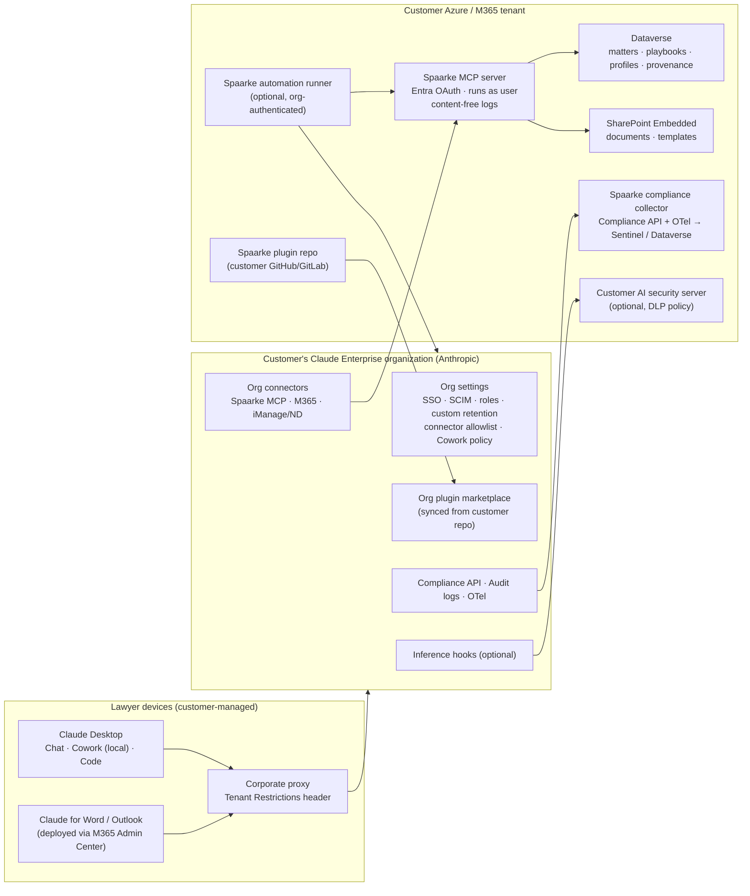

# Spaarke Legal AI Solution Accelerator for Claude
## Design Document — Built on the Customer's Claude Enterprise Account

| | |
|---|---|
| Document | Design specification, v0.3 (draft for review) |
| Product | Spaarke Legal AI Solution Accelerator — Claude edition |
| Companion package | Spaarke Legal AI Accelerator for Microsoft Copilot (Word + Cowork) |
| Date | November 7, 2026 |
| Change from v0.1 | Re-based on the customer's existing Claude Enterprise organization. Removed the customer-cloud inference design. Added the "inherit, don't bypass" principle, a surface-by-surface governance map, bypass risks and their controls, and a conformance check. v0.3 adds self-install options (section 8): self-install inside the organization account, individual accounts, standalone vs connected mode, and consumer-terms safeguards. |

---

## 1. Executive summary

The Claude edition of the Spaarke Legal AI Accelerator helps a legal department use Claude for legal work. It packages Anthropic's open-source Claude for Legal plugins with Spaarke's playbooks, templates, skills, scripts and connectors to Spaarke (Dataverse and SharePoint Embedded).

**Core design decision:** the Accelerator runs entirely inside the customer's existing Claude Enterprise organization. The customer has already negotiated and configured its Anthropic contract, retention, audit and security controls with its IT and legal teams. The Accelerator inherits those controls. It doesn't replace them, add to them, or route around them.

This puts Spaarke in line with how large firms already use Claude:

- Freshfields gives 5,700 people Claude access and uses it daily on client matters. It plans to expand to Cowork "in line with" its security and compliance frameworks ([Freshfields](https://www.freshfields.com/en/our-thinking/news/news-search/2026/04/freshfields-and-anthropic-team-up-to-co-build-ai-legal-workflows-deploying-claude-across-the-firm-globally)).
- KPMG has embedded Cowork in its Azure-based Digital Gateway platform for 276,000+ staff ([Anthropic](https://www.anthropic.com/news/anthropic-kpmg)).

The design rests on one governing principle:

> **Inherit, don't bypass.** Every piece of customer content the Accelerator touches flows only through surfaces governed by the customer's Claude Enterprise organization, or stays in the customer's own Microsoft tenant. The Accelerator creates no new Anthropic account, API key, data path, or storage location outside the customer's control.

The research produced three findings that matter for the design:

1. **Not every Claude surface follows the organization's retention setting.** The Accelerator must account for each one (section 4):
   - Claude for Word deletes inputs and outputs within 30 days and does not inherit custom retention ([Claude Docs](https://claude.com/docs/office-agents/word)).
   - Local Cowork history lives on users' computers and can't be centrally deleted ([Claude Help](https://support.claude.com/en/articles/13455879-use-claude-cowork-on-team-and-enterprise-plans)).
   - Managed Agents transcripts persist until deleted ([Anthropic](https://platform.claude.com/docs/en/manage-claude/api-and-data-retention)).
2. **Some easy ways to "go around" the enterprise setup exist, and Claude provides controls for each** (section 5). Examples: personal accounts, standalone API keys, side-loaded plugins and unapproved connectors. The matching controls include Tenant Restrictions, forced organization sign-in for Claude Code, organization plugin marketplaces and connector allowlists.
3. **The legal AI vendors' standard is stricter than Claude Enterprise's defaults.**
   - Harvey says every law firm and enterprise contract it signs requires zero data retention ([Harvey](https://www.harvey.ai/blog/why-we-built-our-own-cloud-agent-infrastructure)), and it requires no human review and no training from model providers ([Harvey](https://www.harvey.ai/blog/how-harveys-building-a-culture-of-privacy)).
   - Claude Enterprise instead offers admin-set retention, no training by default, and logged human review of flagged content only ([Anthropic](https://support.claude.com/en/articles/15707726)).

   Spaarke should be transparent about this difference. It should also hold Spaarke's own components to a strict standard: Spaarke stores nothing outside the customer's tenant.
4. **Users can install the Accelerator themselves, but the account they use decides the data terms** (section 8).
   - Inside a Team or Enterprise org, a self-installed plugin runs under the org's controls, as long as the org's policy allows member plugins.
   - Members can't add custom connectors themselves, so every skill needs a standalone mode that works without the Spaarke connector.
   - Free, Pro and Max accounts fall under consumer terms. Data can be used for training if the user's setting is on ([Anthropic](https://www.anthropic.com/news/updates-to-our-consumer-terms)). The Accelerator therefore treats individual accounts as an evaluation and non-confidential option, with an explicit notice.

---

## 2. Context: how legal organizations govern hosted Claude

### 2.1 What corporate and law firm buyers rely on

Claude Enterprise offers these controls ([Claude Enterprise](https://claude.com/solutions/enterprise)):

| Category | Controls |
|---|---|
| Contract | Commercial terms, a data processing agreement, and no training on prompts, files or outputs by default. Anthropic calls these the baseline for legal technology ([Anthropic](https://support.claude.com/en/articles/15707726)). |
| Retention and encryption | Custom data retention; customer-managed encryption keys; US-only inference |
| Identity and access | SAML single sign-on, domain capture, SCIM provisioning, role-based access, custom roles and groups |
| Network | IP allowlisting; Tenant Restrictions to block personal and non-corporate Claude accounts ([Claude Help](https://support.claude.com/en/articles/13198485-enforce-network-level-access-control-with-tenant-restrictions)) |
| Visibility | Audit logs; the Compliance API (activity, chats, files, projects, sessions); OpenTelemetry export; usage analytics |
| Connector governance | Admin-approved connectors with per-tool permissions; connectors respect users' existing permissions |
| Prompt governance | Inference hooks: every governed prompt in claude.ai, Cowork and Claude Code is held for an allow/deny verdict from the customer's own security server, with denials recorded in the compliance Activity Feed ([Claude Platform docs](https://platform.claude.com/docs/en/manage-claude/inference-hooks)) |
| Human review | Only content flagged by automated safety systems can be reviewed, by a small designated team under confidentiality; with Access Transparency every human read is logged for the customer ([Anthropic](https://support.claude.com/en/articles/15707726)) |
| Certifications | SOC 2, ISO 27001, GDPR, CCPA; HIPAA-ready configuration with a BAA |

On privilege, Anthropic's guidance notes that sharing information with a vendor bound by confidentiality doesn't by itself waive privilege. It also cites courts that have accepted AI use where the provider is contractually barred from training on or keeping the data beyond what the service needs ([Anthropic](https://support.claude.com/en/articles/15707726)). Law firms add their own policies on top. Among firms of 350–699 lawyers in ILTA's 2026 survey, 98% had a formal AI policy and 38% required client approval ([Clean, citing ILTA](https://www.tryclean.ai/solutions/legal/amlaw-200)).

### 2.2 How Harvey and Legora position themselves

| | Harvey | Legora |
|---|---|---|
| Model-provider terms | Zero data retention, no human review ("eyes off"), no training ([Harvey](https://www.harvey.ai/blog/how-harveys-building-a-culture-of-privacy)) | Only models that store no data; no human review or abuse monitoring; providers attest data is never logged, stored or trained on ([Legora whitepaper](https://ally-law.com/wp-content/uploads/2026/03/Legora-Security-Whitepaper.pdf)) |
| Agent runtime | Built its own because the labs' hosted agent runtimes don't offer zero retention ([Harvey](https://www.harvey.ai/blog/why-we-built-our-own-cloud-agent-infrastructure)) | Not stated |
| Hosting and residency | Azure; US, EU/Switzerland or Australia ([Harvey](https://www.harvey.ai/security)) | Azure; US, EU and Asia-Pacific instances ([Legora whitepaper](https://ally-law.com/wp-content/uploads/2026/03/Legora-Security-Whitepaper.pdf)) |
| Customer controls | Retention policies, SAML SSO, audit logs, IP allowlisting; ISO 27001/27701/42001 ([Harvey](https://www.harvey.ai/security)) | Customer-set retention, bring-your-own-key encryption, engineer access only with written approval ([Legora](https://legora.com/security)) |
| Ethical walls | Synced from iManage or Intapp ([Harvey](https://www.harvey.ai/blog/ethical-walls-harvey-imanage)) | Not stated |

**What this means for Spaarke:**

- When customers use Claude through their own Enterprise account, Claude Enterprise's controls apply, and the customer has accepted them.
- Spaarke's own components should meet the platform-vendor bar: no Spaarke copies of content, no Spaarke access without customer approval, ethical walls enforced, and full traceability.
- Section 12 tells customers plainly which standard applies where.

---

## 3. Governing principles

| ID | Principle | What it means for the build |
|---|---|---|
| **G-1** | **One envelope** | All Claude activity happens under the customer's Claude Enterprise organization (or a Claude Platform organization linked under the same parent organization). No other Anthropic tenancy is used. |
| **G-2** | **Customer-owned credentials only** | Spaarke never holds an Anthropic account, API key or Compliance key that processes customer content. Customer users sign in with their own Enterprise identities. Any service credentials belong to the customer's organization and live in the customer's Key Vault. |
| **G-3** | **Admin-native distribution** | Plugins ship through the customer's organization plugin marketplace. Connectors are added by the customer's Owners in Organization settings. The Word add-in is deployed by the customer's Microsoft 365 admin. Nothing is side-loaded. |
| **G-4** | **No shadow storage** | Spaarke components (MCP server, scripts, automations) keep no prompts, completions or document text outside records the customer governs in Dataverse and SharePoint Embedded. Logs carry metadata, not content. |
| **G-5** | **Visible to the customer's compliance tools** | Every Accelerator action should appear in the customer's Compliance API, OpenTelemetry feed, Microsoft 365 audit log, or Dataverse audit. Prefer surfaces with that coverage. |
| **G-6** | **Least capability** | Write and send tools require approval. Features the customer hasn't approved stay off. The Accelerator never asks customers to loosen a setting. |
| **G-7** | **Existing permissions and walls** | Every data access runs as the signed-in user, with Dataverse security and iManage/Intapp ethical walls applied. |
| **G-8** | **Lawyer-directed** | Output is the lawyer's draft. Upstream Claude for Legal gates before filing, sending or relying on output stay in place ([claude-for-legal](https://github.com/anthropics/claude-for-legal)). |

---

## 4. Governance map: what the customer's Enterprise controls cover, by surface

The Accelerator uses several Claude surfaces, and they don't all behave the same way. Customers need to see this table before rollout.

| Surface | Where content is processed and kept | Follows org custom retention? | Audit / compliance coverage | Accelerator stance |
|---|---|---|---|---|
| **Claude chat and Projects** (web, Desktop) | Anthropic, in the customer's org | **Yes**. Chats, files and projects follow the org's policy ([Anthropic](https://platform.claude.com/docs/en/manage-claude/api-and-data-retention)). Custom retention minimum is 30 days ([Claude Help](https://support.claude.com/en/articles/17444462-set-up-and-manage-the-new-unified-claude-experience-for-your-enterprise-organization)). | Audit logs; Compliance API | **Primary surface** |
| **Cowork, local sessions** (Claude Desktop) | Model calls go to Anthropic. Conversation history is stored on the user's computer and isn't subject to standard retention; admins can't centrally manage or delete it ([Claude Help](https://support.claude.com/en/articles/13455879-use-claude-cowork-on-team-and-enterprise-plans)). | **Partly.** Local session transcripts kept by Anthropic follow the org's retention only if a finite period is set; otherwise they're kept for 6 years ([Anthropic](https://platform.claude.com/docs/en/manage-claude/api-and-data-retention)). | Compliance API (last 30 days). Cowork isn't in audit logs ([Claude Academy](https://academy.claude.com/tutorials/claude-cowork-enterprise-administrator-guide)). OpenTelemetry events for tool calls, file access and approvals ([Claude](https://claude.com/resources/articles/cowork-for-enterprise)). | **Primary surface.** Requires a finite retention period (C-1) and endpoint controls for local history (C-12) |
| **Cowork in the cloud** | Anthropic; sessions and files saved to the member's account. Off by default on Enterprise ([Claude Help](https://support.claude.com/en/articles/13455879-use-claude-cowork-on-team-and-enterprise-plans)). | **No default retention period** for remote session transcripts ([Anthropic](https://platform.claude.com/docs/en/manage-claude/api-and-data-retention)) | Compliance API | **Not used** unless the customer turns it on deliberately |
| **Claude for Word / Outlook / Excel / PowerPoint** | Anthropic. The add-in sends document content Claude reads and attached files ([Claude Docs](https://claude.com/docs/office-agents/word)). | **No.** Inputs and outputs are deleted within 30 days; custom retention isn't inherited. Chat history is kept in browser storage ([Claude Docs](https://claude.com/docs/office-agents/word)). | Not in audit logs; covered by the Compliance API ([Claude Docs](https://claude.com/docs/office-agents/word)), including drafted email and document text ([Claude Help](https://support.claude.com/en/articles/15167101-get-started-with-claude-compliance-api-integrations)) | **Primary for document work.** Disclose the 30-day behaviour |
| **Claude Code / Agent SDK** (builders, scripted jobs) | Anthropic, under the org login | Local session transcripts follow the same rule as local Cowork ([Anthropic](https://platform.claude.com/docs/en/manage-claude/api-and-data-retention)). A separate zero-retention offering exists for qualified Enterprise accounts ([Anthropic](https://platform.claude.com/docs/en/manage-claude/api-and-data-retention)). | Compliance API; OpenTelemetry | **Used for building and for automation**, with forced org sign-in (C-6) |
| **Claude Platform API and Managed Agents** | Anthropic, in a Claude Platform org | **No.** API retention is separate from claude.ai settings. Managed Agents transcripts persist until deleted, including with self-hosted sandboxes ([Anthropic](https://platform.claude.com/docs/en/manage-claude/api-and-data-retention)). | Compliance API (Platform customers) ([Claude](https://claude.com/resources/articles/claude-platform-compliance-api)) | **Optional, customer-approved only.** Must be a Platform org linked under the customer's parent org; Spaarke's runner deletes sessions per customer policy |
| **Microsoft 365 connector** (Anthropic-hosted) | Proxy to the customer's tenant; no file caching; tool results in stored chats are retained with the chat ([Claude Help](https://support.claude.com/en/articles/12684923-microsoft-365-connector-security-guide)) | Yes, as part of the chat | Graph calls appear in the customer's Microsoft 365 audit log ([Claude Help](https://support.claude.com/en/articles/12684923-microsoft-365-connector-security-guide)) | **Allowed** where the customer has enabled it |
| **Spaarke MCP connector** (customer-hosted) | Customer Azure; results flow into the Claude conversation | Yes, as part of the chat; Spaarke-side records follow the customer's Dataverse policy | Compliance API (conversation) + Dataverse audit + Spaarke metadata logs | **Core component** |
| **Third-party connectors** (iManage, NetDocuments, research vendors) | The connector vendor plus the Claude conversation | Conversation side follows the surface | Vendor logs; iManage applies security policies per request ([iManage](https://docs.imanage.com/cloud/spm-admin-help/en-US/Appendix__iManage_MCP_Server_and_iManage_SPM.html)) | DMS connectors allowed if the customer already uses that vendor; research connectors only with customer approval |

---

## 5. Bypass risks and controls

The main risk to this design is not the customer's enterprise controls. It is Claude usage that quietly runs outside them. Each item below is a way content could leave the governed envelope, with the control that closes it. The Accelerator checks these at install time (section 10).

| # | How the setup could be bypassed | Control | Owner |
|---|---|---|---|
| B-1 | A lawyer uses a **personal Claude account** (web, Desktop or mobile) for client work | **Tenant Restrictions**: the corporate proxy adds the `anthropic-allowed-org-ids` header so only approved organizations can be used on the corporate network ([Claude Help](https://support.claude.com/en/articles/13198485-enforce-network-level-access-control-with-tenant-restrictions)). **Restrict organization creation** on verified domains blocks new personal accounts there ([Claude Help](https://support.claude.com/en/articles/18232924-get-started-with-centralized-management)). | Customer IT |
| B-2 | The **Word add-in is signed in with a personal account** | Deploy the add-in centrally from Microsoft 365 Admin Center; Tenant Restrictions apply to `claude.ai` and `api.anthropic.com` traffic | Customer IT |
| B-3 | **Claude Code or the Agent SDK uses an API key** or another organization | Managed settings: `forceLoginMethod: "claudeai"` and `forceLoginOrgUUID: <customer org>`. Claude Code then refuses claude.ai logins to other organizations and blocks `ANTHROPIC_API_KEY`, `ANTHROPIC_AUTH_TOKEN` and `apiKeyHelper` at startup ([Claude Code docs](https://code.claude.com/docs/en/authentication)). Gaps: the interactive `/login` screen can still complete a Console login, and `claude setup-token` can mint a token in another org ([Claude Code docs](https://code.claude.com/docs/en/authentication)). Remove saved Console keys and restrict Console access. | Customer IT; Spaarke ships the managed-settings file |
| B-4 | **Spaarke itself calls Claude** with customer content using a Spaarke-owned key | **Prohibited (G-2).** Any server-side Claude call uses the customer's linked Platform organization, a customer-owned key in customer Key Vault, and runs in the customer's tenant | Spaarke |
| B-5 | **Side-loaded or community plugins** with code or connectors that send data elsewhere | Distribute only through the organization marketplace (Required / Installed by default). Owners control the publishing policy. Member-created plugins have no organization availability setting ([Claude Docs](https://claude.com/docs/plugins/admin)). Review community skills for injection and license issues before adding, as the upstream `legal-builder-hub` does ([claude-for-legal](https://github.com/anthropics/claude-for-legal)). | Customer Owners; Spaarke review process |
| B-6 | **Unapproved connectors or MCP servers** | Owners choose connectors under Organization settings > Connectors. Plugin availability doesn't add bundled connectors on its own ([Claude Docs](https://claude.com/docs/plugins/admin)). The Accelerator's plugins bundle only the Spaarke MCP server. | Customer Owners |
| B-7 | **Cowork's network permissions don't cover web fetch, web search or MCPs** | Network egress permissions don't apply to web fetch, web search or MCPs, including Claude in Chrome. Owners can turn off web search and Claude in Chrome separately ([Claude Help](https://support.claude.com/en/articles/13455879-use-claude-cowork-on-team-and-enterprise-plans)). Recommend off by default for matter work. | Customer Owners |
| B-8 | **Cloud Cowork or Claude Tag** sessions with no default retention | Leave "Run Cowork in the cloud" off (the Enterprise default) unless approved ([Claude Help](https://support.claude.com/en/articles/13455879-use-claude-cowork-on-team-and-enterprise-plans)) | Customer Owners |
| B-9 | **Write tools auto-approved** without a human check | Keep "Allow 'Always allow' for connector tools" off (the default). Custom connector tools without read-only annotations are gated ([Claude Help](https://support.claude.com/en/articles/13455879-use-claude-cowork-on-team-and-enterprise-plans)). Spaarke marks its read-only tools so only write tools prompt. | Customer Owners; Spaarke |
| B-10 | **Spaarke MCP server or scripts keep copies** of content in logs, caches or temp storage | G-4: content-free logging (hashes and IDs), no response caching, temp files deleted at the end of each request; verified by a log review test | Spaarke |
| B-11 | **Managed Agents sessions persist** after the work is done | Use only with customer approval; the runner deletes sessions per the customer's retention policy; prefer Cowork or the Agent SDK under the org login | Spaarke + customer |
| B-12 | **Local Cowork history on laptops** that admins can't centrally delete | Disk encryption, MDM, managed device policy, offboarding wipe; Compliance API for retrieval ([Claude Help](https://support.claude.com/en/articles/13455879-use-claude-cowork-on-team-and-enterprise-plans)) | Customer IT |
| B-13 | **Copying content into tools outside Claude** (a research vendor, a personal email) | Confidentiality gate hook in Spaarke plugins; optional customer inference hook server for DLP (section 6.3) | Spaarke + customer security |

---

## 6. Reference architecture



### 6.1 Component inventory

| Component | Hosted in | Purpose | Customer content held |
|---|---|---|---|
| Customer Claude Enterprise org | Anthropic (customer contract) | Model access, chat, Cowork, add-ins, admin controls | Per surface (section 4) |
| Spaarke plugins (`spaarke-legal-core`, practice overlays) + upstream Claude for Legal | Customer repository → org marketplace | Skills, commands, agents, hooks, connector config | None |
| Spaarke MCP server | Customer Azure (Container Apps / App Service) | Matter context, playbooks, practice profile, documents, write-back with provenance | None beyond Dataverse/SPE records |
| Dataverse + SharePoint Embedded | Customer tenant | System of record for matters, documents, playbooks, profiles and AI provenance | Yes, under customer retention |
| Spaarke compliance collector | Customer Azure | Pulls Compliance API data and receives OpenTelemetry; joins with Spaarke provenance for matter-level audit | Yes, in the customer's SIEM / Dataverse |
| Optional automation runner | Customer Azure | Scheduled and event-driven jobs (section 7.5) | Job state in Dataverse |
| Optional AI security server | Customer Azure | Inference-hook allow/deny policy (DLP, matter restrictions) | Receives transcripts; must run in the customer tenant |

### 6.2 Spaarke MCP server and the Claude org

- **Registration:** the customer's Owner adds the Spaarke MCP server under Organization settings > Connectors. Members then connect with their own Entra accounts ([Claude Docs](https://claude.com/docs/plugins/admin)).
- **Data flow:** content returned by Spaarke tools becomes part of the Claude conversation and is retained with it, as the M365 connector guide describes for connector results ([Claude Help](https://support.claude.com/en/articles/12684923-microsoft-365-connector-security-guide)). That keeps it inside the customer's Claude retention and Compliance API coverage.
- **Network reachability:** remote connectors are called from Anthropic's infrastructure, so the endpoint must be reachable over HTTPS with Entra OAuth. Restrict inbound traffic to Anthropic's published egress ranges plus the customer's networks. Confirm the current IP list during the build.
- **Word add-in connectors:** the add-in uses the organization's connectors and skills. Test the Spaarke connector specifically in the add-in during the pilot.

### 6.3 Optional inference hooks

For customers that want hard DLP rules (for example, blocking matter numbers from restricted clients, or blocking privileged-labelled text from certain surfaces), the Accelerator includes a reference AI security server. Inference hooks send each governed prompt across claude.ai, Cowork and Claude Code to this server for an allow/deny verdict before inference ([Claude Platform docs](https://platform.claude.com/docs/en/manage-claude/inference-hooks)).

Because this server receives conversation transcripts, it must run in the customer's tenant under G-4. The docs don't list the Office add-ins, so confirm their coverage.

---

## 7. Surfaces in detail

### 7.1 Chat and Projects

- **Use:** quick questions, matter research and Projects tied to a matter or practice area.
- **Behaviour:** fully governed by the org's retention setting and covered by audit logs and the Compliance API.
- **Practice profile:** loaded through the Spaarke MCP tool `profile.get`, not pasted into project instructions, so there's one governed source.

### 7.2 Cowork (local) in Claude Desktop

- **Use:** the main workspace for multi-step legal work — playbook review across a folder of agreements, issues lists, diligence grids, closing checklists. The Accelerator's `.py` scripts run here.
- **Plugins:** delivered through the organization marketplace as Required or Installed by default, with group-level overrides for practice teams ([Claude Help](https://support.claude.com/en/articles/13455879-use-claude-cowork-on-team-and-enterprise-plans)).
- **Telemetry:** stream OpenTelemetry to the customer's SIEM for tool calls, file access and approval decisions. Anthropic notes this supplements audit logging rather than replacing it ([Claude Help](https://support.claude.com/en/articles/13455879-use-claude-cowork-on-team-and-enterprise-plans)).
- **Retention:** requires the customer to set a finite custom retention period. Otherwise local session transcripts held by Anthropic default to 6 years ([Anthropic](https://platform.claude.com/docs/en/manage-claude/api-and-data-retention)).

### 7.3 Claude for Word and Outlook

- **Use:** in-document review against the playbook, counterparty redline triage, tracked-change redlines, comment replies and clause drafting. Claude reads the open document, including comments, tracked changes, footnotes and tables ([Claude Docs](https://claude.com/docs/office-agents/word)).
- **Deployment:** centrally from Microsoft 365 Admin Center, with users signed in to the customer's Claude Enterprise org.
- **Disclosure items:**
  - Add-in inputs and outputs are deleted within 30 days, whatever the org's custom retention setting.
  - Chat history sits in browser storage, and clearing it doesn't delete Anthropic's copy.
  - Activity isn't in audit logs but is in the Compliance API ([Claude Docs](https://claude.com/docs/office-agents/word)).
  - Customers with retention periods longer than 30 days should know add-in sessions won't be retained that long, which matters for litigation-hold expectations. The Spaarke compliance collector can pull add-in sessions from the Compliance API into customer storage if the customer needs longer retention.
- **Skill design:** Word-facing skills must work even without the Spaarke connector, falling back to the playbook embedded in the skill. Prompt-injection guidance applies to counterparty documents ([Claude Docs](https://claude.com/docs/office-agents/word)).

### 7.4 Claude Code (builders)

Spaarke and customer builders use Claude Code to maintain skills, scripts and the MCP server. Machines get the managed-settings file from control B-3 so every session is tied to the customer org. The Agent SDK checks `forceLoginOrgUUID` on claude.ai logins ([Claude Code docs](https://code.claude.com/docs/en/authentication)).

### 7.5 Automations (renewals, obligations, monitoring, intake)

These options are listed in order of preference:

1. **Cowork scheduled tasks (local).** Runs inside the governed Cowork envelope. Limitation: the user's device must be on.
2. **Spaarke runner using the Agent SDK under the customer's org login.** Runs in the customer's Azure, with session transcripts governed like Claude Code. Open item: confirm with Anthropic that unattended org-authenticated use is permitted under the customer's Enterprise terms.
3. **Managed Agents in a Claude Platform organization linked under the customer's parent organization.** Gives the most capability, but sessions persist until deleted and fall outside Enterprise custom retention ([Anthropic](https://platform.claude.com/docs/en/manage-claude/api-and-data-retention)). Use only with written customer approval. The runner deletes each session when the job finishes and keeps results in Dataverse. Claude for Legal ships Managed Agents cookbooks (renewal watcher, docket watcher and others) that can be adapted ([claude-for-legal](https://github.com/anthropics/claude-for-legal)).

---

## 8. Installation options: admin-managed and self-install

The Accelerator supports three installation paths. All three follow the same rule: the user's data stays under the account the user is signed in to, and the Accelerator never redirects work to a different account to get around a restriction.

| Mode | Who installs | Account and terms | Plugins | Spaarke connector | Word add-in |
|---|---|---|---|---|---|
| **A. Organization-managed** (default) | Customer's Claude Owners and M365 admin | Customer's Team or Enterprise org, under Anthropic's Commercial Terms | Org marketplace, Required or Installed by default | Added by an Owner under Organization settings > Connectors | Centrally deployed from Microsoft 365 Admin Center |
| **B. Self-install inside the organization account** | An individual lawyer, in their own seat in the customer's Team or Enterprise org | Same org and terms as Mode A; the org's retention, audit and Compliance API all apply | User adds the Spaarke marketplace by URL or uploads the plugin zip under Customize > Plugins > Add, **only if** the org's "User-created skills" policy allows it ([Claude Docs](https://claude.com/docs/plugins/admin)) | **Can't be self-added.** On Team and Enterprise, only Owners (or Enterprise custom roles with Libraries access) add custom connectors ([Claude Help](https://support.claude.com/en/articles/11175166-get-started-with-custom-connectors-using-remote-mcp)). Plugins run in standalone mode until an Owner adds it. | User installs from Microsoft AppSource ("Get it now") and signs in with their Claude org account ([Claude Docs](https://claude.com/docs/office-agents/word)) |
| **C. Individual account** (solo practitioner, evaluator, small firm without Claude Team) | The user, in their own Claude account | **Pro, Max or Ultra:** Anthropic's consumer terms (see 8.3). **Own Team plan:** Commercial Terms. | Customize > Plugins > Add (marketplace URL or zip) ([Claude Help](https://support.claude.com/en/articles/13837440-use-plugins-in-claude)); Claude Code: `claude plugin marketplace add` / `claude plugin install` | Pro/Max users can add a custom remote connector themselves under Customize > Connectors ([Claude Help](https://support.claude.com/en/articles/11176164-use-connectors-to-extend-claude-s-capabilities)). Only meaningful if the user has a Spaarke deployment to connect to. | Same AppSource install, signed in with the personal Claude account |

### 8.1 What self-install changes, and what it doesn't

- **It doesn't change who governs the data.** In Mode B, a self-installed plugin runs inside the customer's org exactly like an admin-installed one. Chats, Cowork sessions and Word add-in sessions are still subject to the org's retention, audit and Compliance API coverage (section 4). Plugins added in Claude on the web or Desktop are saved to the user's account for the organization they're in ([Claude Docs](https://claude.com/docs/plugins/platform-support)).
- **It can't unlock what the admin has disabled.**
  - If the org has turned off "User-created skills," the plugin options don't appear ([Claude Docs](https://claude.com/docs/plugins/admin)). Self-install is then unavailable, and the user is directed to their admin.
  - The Accelerator's documentation and setup skill must never suggest workarounds: no switching to a personal account, no API key, no unapproved connector. This is the Mode B form of controls B-1 to B-6.
- **It works without the Spaarke connector.** Because members can't add custom connectors on Team or Enterprise, every Spaarke skill must have a **standalone mode**:
  - playbooks and templates bundled as plugin reference files;
  - the practice profile captured by the setup interview and saved locally, as upstream Claude for Legal does ([claude-for-legal](https://github.com/anthropics/claude-for-legal));
  - documents supplied by upload or from the open Word document.

  **Connected mode** (Dataverse, SharePoint Embedded, provenance write-back) turns on automatically once an Owner adds the Spaarke connector.
- **Getting to an organization-wide rollout:** a Mode B user who likes the Accelerator can use **Publish to org**, subject to the org's publishing policy (Requires review, Open or Off) ([Claude Docs](https://claude.com/docs/plugins/admin)). On Team plans, admins can pilot a plugin with a few people first ([Claude Docs](https://claude.com/docs/plugins/admin)). This gives a clean path from Mode B to Mode A.
- **Updates:** marketplace installs sync from the Spaarke repository. Zip uploads don't auto-update, so the setup skill checks its version against the published release and tells the user when an update exists.

### 8.2 Self-install for the Word add-in

- **How:** users can install Claude for Word themselves from the Claude for Microsoft 365 listing on Microsoft AppSource, then sign in with their Claude account ([Claude Docs](https://claude.com/docs/office-agents/word)). Whether the store is reachable depends on the customer's Microsoft 365 setting "Let users access the Office Store" ([Claude Docs](https://claude.com/docs/office-agents/word)). That is the customer's decision, not the Accelerator's.
- **Data handling:** the same as admin deployment. Inputs and outputs are deleted within 30 days, and sessions are covered by the Compliance API for Enterprise orgs ([Claude Docs](https://claude.com/docs/office-agents/word)).
- **Skills:** Spaarke's Word skills reach the add-in through the user's installed plugins and skills. Test this per plan type during the pilot.

### 8.3 Individual accounts (Mode C): consumer terms warning

- **Training and retention terms:**
  - Free, Pro and Max plans, including Claude Code used from those accounts, are under Anthropic's consumer terms. Anthropic trains new models on that data when the user's training setting is on, and keeps it for five years in that case. If the user opts out, the 30-day retention period applies ([Anthropic](https://www.anthropic.com/news/updates-to-our-consumer-terms)).
  - These terms don't apply to Team, Enterprise or the API ([Anthropic](https://www.anthropic.com/news/updates-to-our-consumer-terms)).
  - Ultra appears to be another individual tier, but this update doesn't name it. Confirm its terms before supporting it.
- **Privilege risk:** in *United States v. Heppner*, the court found that a defendant's own use of a consumer AI account, without lawyer involvement, was not privileged work product. The reasoning turned on consumer privacy terms ([Anthropic](https://support.claude.com/en/articles/15707726)).

**Accelerator rules for Mode C:**

1. Supported for evaluation, training, and non-confidential work. For client-confidential matters, the Accelerator recommends a Team or Enterprise account under Commercial Terms.
2. The `spaarke-start` setup skill shows a one-time data-handling notice before first use. It asks the user to confirm their plan type and, for Pro/Max, that the model-training setting is off. The confirmation is recorded in the local practice profile.
3. Skills stamp a reminder on deliverables produced under an individual consumer account, so the user can decide whether the work product is appropriate for client use.
4. Spaarke doesn't host a shared, multi-customer connector for individual users. Connected mode requires a Spaarke deployment in a tenant the user's organization controls, which keeps G-4 (no shadow storage) intact.

### 8.4 Packaging requirements for self-install

| Requirement | Implementation |
|---|---|
| Installable by URL | The Spaarke marketplace is published as a Git repository (public for the open edition, or private with the user's Git credentials) |
| Installable by file | Versioned plugin zip in each release |
| Standalone mode | Every skill works without the Spaarke connector; connected-mode features detect the connector and degrade gracefully |
| First-run setup | `spaarke-start` skill: detects the install mode, runs the practice-profile interview, shows the data-handling notice, points Mode B users to their admin for the connector |
| No credentials in the package | Plugins contain no API keys, tokens or Spaarke service endpoints that receive content |
| Same guardrails | Confidentiality gate, provenance and injection-screen hooks apply in all modes (provenance is written locally in standalone mode) |

---

## 9. Accelerator package contents

### 9.1 Repository layout

```text
spaarke-legal-accelerator-claude/
├── README.md
├── LICENSE / NOTICE                    # Apache-2.0 attribution for upstream Claude for Legal
├── docs/
│   ├── customer-data-handling-summary.md   # section 12
│   ├── self-install-guide.md               # Modes B and C (section 8)
│   ├── admin-baseline.md                   # section 10 checklist
│   └── runbooks/
├── upstream/claude-for-legal/          # pinned to reviewed commits
├── plugins/
│   ├── spaarke-legal-core/
│   │   ├── .claude-plugin/plugin.json
│   │   ├── CLAUDE.md                   # thin pointer to the MCP practice profile
│   │   ├── skills/
│   │   ├── agents/
│   │   ├── hooks/                      # confidentiality gate, provenance writer, injection screen
│   │   └── .mcp.json                   # Spaarke MCP only
│   └── spaarke-<practice>/
├── marketplace/marketplace.json        # org marketplace sync, and add-by-URL for self-install (section 8)
├── releases/                           # versioned plugin zips for upload-based self-install
├── content/
│   ├── playbooks/*.yaml
│   ├── templates/*.docx
│   ├── clause-library/
│   └── profiles/schema.json
├── mcp-server/                         # Dataverse + SharePoint Embedded tools
├── compliance-collector/               # Compliance API + OTel → Sentinel / Dataverse
├── inference-hook-server/              # optional reference DLP policy server
├── automation-runner/                  # optional Agent SDK jobs
├── deploy/
│   ├── bicep/                          # MCP, collector, runner, Key Vault
│   ├── claude-code/managed-settings.json   # forceLoginMethod / forceLoginOrgUUID
│   ├── proxy/tenant-restrictions/      # header-injection examples for common proxies
│   ├── intune/                         # Claude Desktop deployment
│   └── m365/                           # Word / Outlook add-in deployment notes
├── conformance/check_tenant.py         # section 10 automated checks
├── build/pack.py, build/check.py       # one source → Claude, Microsoft, OpenAI packages
└── evals/                              # contract corpus, expected issues, runner
```

The single-source build follows LegalQuants' pattern: one `skills/` tree builds several bundles, with a `pack --check` step confirming generated files match the source ([LegalQuants lq-plugin-oss](https://github.com/LegalQuants/lq-plugin-oss)).

### 9.2 Base plugins

- **Base:** [Claude for Legal](https://github.com/anthropics/claude-for-legal) (Apache-2.0) provides 12+ practice plugins with setup interviews, skills, agents, hooks and connector configuration.
- **Strategy:** install the upstream plugins pinned through the customer's marketplace, and add Spaarke's overlay rather than forking.
- **Connector changes:** upstream connector entries the customer hasn't approved are removed in the Spaarke overlay, so plugins never prompt users to connect services outside the allowlist.
- **Practice profile:** keep upstream's setup interview, but save the result to Dataverse through `profile.save` with versioning and approval. That gives one governed profile per department instead of one per laptop.

### 9.3 Spaarke skill catalog (v1)

| Skill | Surface | Description | MCP tools |
|---|---|---|---|
| `spaarke-start` | All | First-run setup: install-mode detection, practice-profile interview, data-handling notice, version check | `profile.save` (connected mode only) |
| `spaarke-matter-context` | Cowork, Chat, Word | Load matter, parties, counterparty history, applicable playbook | `matter.get`, `playbook.resolve` |
| `spaarke-playbook-review` | Cowork, Word | Clause-by-clause review against the structured playbook; GREEN/YELLOW/RED; fallback language | `playbook.get`, `clause.search` |
| `spaarke-redline-triage` | Word | Group counterparty changes by severity; draft responses | `playbook.get` |
| `spaarke-issues-list` | Cowork | Issues list in house format; save to SharePoint Embedded | `document.save` |
| `spaarke-obligations-extract` | Cowork, runner | Extract obligations and deadlines to Dataverse | `obligation.upsert` |
| `spaarke-intake-triage` | Chat, Cowork, runner | Classify and route requests per the escalation matrix | `matter.create`, `routing.resolve` |
| `spaarke-precedent-find` | Cowork, Word | Find approved precedent in SharePoint Embedded or the DMS | `clause.search`, DMS tools |
| `spaarke-provenance-writeback` | All | Record what was reviewed, the surface, playbook version and approver | `provenance.record` |
| `spaarke-confidentiality-check` | All | Pre-flight sensitivity check before any external tool call | `policy.evaluate` |

### 9.4 Spaarke MCP server requirements

- **Protocol and identity:** Streamable HTTP over HTTPS; Entra OAuth; on-behalf-of access to Dataverse and SharePoint Embedded; runs as the user.
- **Security:** enforces Dataverse security and matter-level ethical walls (synced from iManage or Intapp where present, the pattern Harvey uses ([Harvey](https://www.harvey.ai/blog/ethical-walls-harvey-imanage))).
- **Tool annotations:** read-only tools annotated as such, so Cowork only gates write tools ([Claude Help](https://support.claude.com/en/articles/13455879-use-claude-cowork-on-team-and-enterprise-plans)).
- **No shadow storage (G-4):** no request or response bodies in logs, no caching, temp storage cleared per request. Logs record user, matter ID, tool, timing and input/output hashes.
- **Compatibility:** the same server serves the Microsoft Cowork Accelerator.

### 9.5 Guardrail hooks

- **Confidentiality gate:** blocks matter-tagged content from going to connectors outside an allowlist.
- **Provenance writer:** records deliverables in Dataverse.
- **Prompt-injection screen:** flags hidden text, comments and tracked changes with instruction-like content in counterparty documents.

---

## 10. Customer admin baseline and conformance check

The Accelerator doesn't change the customer's settings. It checks them and reports gaps before go-live. `conformance/check_tenant.py` runs where APIs allow (Admin and Compliance APIs with customer-created keys), and the customer's admin confirms the remaining items manually.

| ID | Setting | Expected | Why |
|---|---|---|---|
| C-1 | Custom data retention | A finite period set by the customer (minimum 30 days) | Makes local Cowork and Claude Code transcripts follow policy instead of 6 years ([Anthropic](https://platform.claude.com/docs/en/manage-claude/api-and-data-retention)) |
| C-2 | Compliance API | On | The only coverage for Cowork and the Word add-in; turning it off stops recording ([Claude Platform docs](https://platform.claude.com/docs/en/manage-claude/compliance-faq)) |
| C-3 | OpenTelemetry | Streaming to the customer's SIEM | Cowork tool and file activity |
| C-4 | SSO required; SCIM; groups and custom roles | On | Identity and least capability |
| C-5 | Tenant Restrictions; restrict organization creation | On | B-1, B-2 |
| C-6 | Claude Code managed settings | `forceLoginMethod`, `forceLoginOrgUUID` deployed | B-3 |
| C-7 | Connector allowlist | Spaarke MCP plus customer-approved connectors only | B-6 |
| C-8 | Cowork in the cloud | Off unless approved | B-8 |
| C-9 | "Always allow" for connector tools | Off | B-9 |
| C-10 | Web search; Claude in Chrome; built-in browser | Per customer policy; recommended off for matter-work groups | B-7 |
| C-11 | Plugin marketplace | Spaarke and upstream plugins synced and pinned; publishing policy restricted | B-5 |
| C-12 | Endpoint controls | Disk encryption and MDM on devices running Desktop | B-12 |
| C-13 | Optional: customer-managed keys, US-only inference, inference hooks | As contracted | Stronger posture |
| C-14 | "User-created skills" and publishing policy | Customer decides whether self-install (Mode B) is allowed; recommended publishing policy "Requires review" | Section 8 |

**Functional conformance tests at pilot:**

1. A personal Claude account is blocked on the corporate network.
2. Claude Code exits when an API key is set.
3. A Word add-in session appears in the Compliance API.
4. A Cowork session's tool calls appear in OpenTelemetry.
5. Spaarke MCP logs contain no planted test-document strings.
6. A walled matter can't be read by a walled-off user through any surface.
7. Self-install (if allowed): a member adds the Spaarke marketplace by URL, the plugin runs in standalone mode, and the session appears in the Compliance API.

---

## 11. Security, governance and professional responsibility

| Area | Approach |
|---|---|
| Identity | Entra ID everywhere; Claude Enterprise SSO; MCP on-behalf-of |
| Access | Dataverse security, ethical walls, connector permissions that respect existing rights |
| Human in the loop | Write and send tools require approval; upstream filing and sending gates |
| Audit | Compliance API + OpenTelemetry + Microsoft 365 audit + Dataverse provenance, joined per matter by the compliance collector |
| Supply chain | Organization marketplace only; pinned versions; review of community skills |
| Prompt injection | Pre-read screening hook; approval on write tools |
| Professional duties | Lawyer-directed drafts, verification against primary sources and documented AI use, in line with Anthropic's guidance and ABA Formal Op. 512 ([Anthropic](https://support.claude.com/en/articles/15707726)) |
| Client consent | Templates for engagement-letter and outside-counsel-guideline responses, since many large firms require client approval ([Clean, citing ILTA](https://www.tryclean.ai/solutions/legal/amlaw-200)) |

---

## 12. Customer data handling summary (template)

A one-page summary the customer's legal and security teams can approve:

1. **What Spaarke adds:**
   - Plugins, skills and playbooks.
   - A connector hosted in the customer's own Azure tenant.
   - Optional automations and compliance tooling, also in the customer's tenant.
2. **What Spaarke does not add:** no new AI vendor, no Spaarke Anthropic account or API key, and no Spaarke copies of prompts, outputs or documents.
3. **Where Claude processing happens:** in the customer's own Claude Enterprise organization, under the customer's contract with Anthropic. That covers no training by default, admin-set retention, and logged human review of flagged content only ([Anthropic](https://support.claude.com/en/articles/15707726)).
4. **Surface exceptions:**
   - Word/Office add-in data is deleted within 30 days regardless of custom retention.
   - Local Cowork history stays on devices.
   - Cloud Cowork is off.
   - Managed Agents are used only if approved.
5. **Self-install:** users who install the Accelerator themselves inside the organization's account are covered by the same terms and controls. Individual consumer accounts (Free, Pro, Max) are under different terms and aren't recommended for client-confidential work (section 8.3).
6. **Audit:** the customer can retrieve Claude activity through the Compliance API and its SIEM, and matter-level provenance from Dataverse.
7. **Comparison with legal AI platforms:** some legal AI vendors advertise zero retention and no human review from their model providers ([Harvey](https://www.harvey.ai/security), [Legora whitepaper](https://ally-law.com/wp-content/uploads/2026/03/Legora-Security-Whitepaper.pdf)). Under this Accelerator, the customer's Claude Enterprise terms apply instead. Matters needing a stricter standard should be handled under the customer's AI policy (for example, excluded from Claude, or raised with Anthropic regarding available zero-retention offerings).

---

## 13. Prior art and reference implementations

| Source | What it is | How we use it |
|---|---|---|
| [anthropics/claude-for-legal](https://github.com/anthropics/claude-for-legal) | Anthropic's legal practice plugins, setup interviews, connector configs, Managed Agents cookbooks (Apache-2.0) | Base layer; guardrail and gating patterns; automation recipes |
| [anthropics/knowledge-work-plugins](https://github.com/anthropics/knowledge-work-plugins) | Anthropic's role plugins for Cowork (Apache-2.0) | Plugin structure and conventions |
| [Claude organization plugin admin](https://claude.com/docs/plugins/admin) | Org marketplaces, availability levels, connector controls | Distribution model (G-3) |
| [LegalQuants lq-plugin-oss](https://github.com/LegalQuants/lq-plugin-oss) | Lawyer-built skills; one source builds multiple bundles with a pack-check step (Apache-2.0) | Single-source, multi-platform build; skill ideas (playbook-review, read-redline, cite-check) |
| [LegalQuants lq-skills](https://github.com/LegalQuants/lq-skills) | Skills from ~100 lawyer-builders, usable across tools | Skill reference library (check licenses per skill) |
| Lawve awesome-legal-skills (formerly Lawvable) | Registry of ~276 legal skills, mostly MIT or AGPL ([HAQQ](https://www.haqq.ai/blog/legal-ai-open-source-moment)) | Discovery; legal review before bundling AGPL items |
| [evolsb/claude-legal-skill](https://github.com/topics/contract-analysis) | Contract-review skill with CUAD-based risk detection | Eval harness ideas (verify license) |
| Harvey and Legora security models ([Harvey](https://www.harvey.ai/security), [Legora](https://legora.com/security)) | Legal AI platform controls: ethical walls, residency, BYOK, eyes-off provider terms | Benchmark for Spaarke's own component standards (G-4, G-7) |
| Freshfields and KPMG deployments ([Freshfields](https://www.freshfields.com/en/our-thinking/news/news-search/2026/04/freshfields-and-anthropic-team-up-to-co-build-ai-legal-workflows-deploying-claude-across-the-firm-globally), [Anthropic](https://www.anthropic.com/news/anthropic-kpmg)) | Firm-wide Claude through the firm's own platform and frameworks | Evidence that hosted Claude under enterprise controls is accepted |
| Spaarke Microsoft Accelerator | Companion package | Shared skills, content and MCP server |

---

## 14. Build plan

| Phase | Scope | Exit criteria |
|---|---|---|
| **0. Policy alignment (2 wks)** | Customer data handling summary; surface decisions (cloud Cowork, Managed Agents, web search); confirm automation licensing with Anthropic | Signed summary and admin baseline |
| **1. Admin baseline (1–2 wks)** | Customer applies C-1 to C-13; Spaarke runs the conformance check | All required checks pass |
| **2. Spaarke MCP server (4–6 wks)** | Matter, document, playbook, profile and provenance tools; walls; content-free logging; Owner registers the connector | Contract tests; walls test; log review |
| **3. Plugins and marketplace (3 wks)** | Upstream pinned + Spaarke overlay; marketplace sync; group targeting | Required plugins appear for the pilot group |
| **3a. Self-install packaging (2 wks)** | Public/private marketplace URL, release zips, standalone mode for every skill, `spaarke-start` notice and mode detection | Mode B and Mode C install tests pass |
| **4. Word / Outlook pilot (3 wks)** | Playbook review and redline triage in Word; Compliance API capture | Conformance tests 3 and 6 pass |
| **5. Compliance collector (2–3 wks)** | Compliance API + OpenTelemetry into Sentinel; matter-level join with provenance | Matter audit report produced |
| **6. Automations (3–4 wks)** | Option 1 or 2 from 7.5; Option 3 only if approved | Jobs write provenance; no orphaned sessions |
| **7. Evals and hardening (ongoing)** | Contract corpus; regression on upstream and model updates | Per-skill accuracy thresholds |
| **8. Multi-platform build** | `pack.py` emits Microsoft and OpenAI packages | Package checks pass |

---

## 15. Risks and open questions

| # | Item | Mitigation / next step |
|---|---|---|
| R-1 | Word add-in retention (30 days) differs from org retention | Disclose; optional export into customer storage through the Compliance API |
| R-2 | Local Cowork history can't be centrally deleted | Endpoint controls; watch for Anthropic's planned deletion endpoints ([Claude Help](https://support.claude.com/en/articles/13455879-use-claude-cowork-on-team-and-enterprise-plans)) |
| R-3 | Default 6-year retention for local transcripts if no finite period is set | Conformance check C-1 |
| R-4 | Claude Code login gaps (interactive Console login, `setup-token`) | Restrict Console access; remove saved keys; periodic scan |
| R-5 | Vendor features and terms change frequently | Re-run the conformance check quarterly and after major Claude releases |
| R-6 | Customers expecting the Harvey/Legora "zero retention, eyes off" standard | Section 12 comparison; customer policy decides matter eligibility |
| R-7 | Self-installed copies drift from the approved version | Version check in `spaarke-start`; Publish to org path to move users to managed installs |
| R-8 | Lawyers use individual consumer accounts for client work | First-run notice, deliverable reminder, Tenant Restrictions on corporate networks (B-1) |
| Q-1 | Is unattended, org-authenticated Agent SDK use permitted under Enterprise terms? | Confirm with Anthropic |
| Q-2 | Do inference hooks cover Office add-in prompts? | Confirm with Anthropic |
| Q-3 | Current egress IP ranges for remote connectors calling the Spaarke MCP server | Confirm during build |
| Q-4 | Can the Compliance API export add-in sessions in time for litigation holds longer than 30 days? | Test in pilot |
| Q-5 | Which data terms apply to the Ultra individual plan? | Confirm with Anthropic |

---

## Appendix A — Key sources

- Anthropic, API and data retention: https://platform.claude.com/docs/en/manage-claude/api-and-data-retention
- Anthropic, Using Claude for legal work (privilege and confidentiality): https://support.claude.com/en/articles/15707726
- Claude Enterprise plan: https://claude.com/solutions/enterprise
- Tenant Restrictions: https://support.claude.com/en/articles/13198485-enforce-network-level-access-control-with-tenant-restrictions
- Centralized management: https://support.claude.com/en/articles/18232924-get-started-with-centralized-management
- Claude Code authentication and forced login: https://code.claude.com/docs/en/authentication
- Cowork on Team and Enterprise plans: https://support.claude.com/en/articles/13455879-use-claude-cowork-on-team-and-enterprise-plans
- Cowork Enterprise admin guide: https://academy.claude.com/tutorials/claude-cowork-enterprise-administrator-guide
- Cowork for enterprise controls: https://claude.com/resources/articles/cowork-for-enterprise
- Unified Claude experience, retention: https://support.claude.com/en/articles/17444462-set-up-and-manage-the-new-unified-claude-experience-for-your-enterprise-organization
- Claude for Word: https://claude.com/docs/office-agents/word
- Compliance API integrations: https://support.claude.com/en/articles/15167101-get-started-with-claude-compliance-api-integrations
- Compliance API FAQ: https://platform.claude.com/docs/en/manage-claude/compliance-faq
- Inference hooks: https://platform.claude.com/docs/en/manage-claude/inference-hooks
- Organization plugin admin: https://claude.com/docs/plugins/admin
- Use plugins in Claude: https://support.claude.com/en/articles/13837440-use-plugins-in-claude
- Plugin feature support across platforms: https://claude.com/docs/plugins/platform-support
- Custom connectors using remote MCP: https://support.claude.com/en/articles/11175166-get-started-with-custom-connectors-using-remote-mcp
- Use connectors: https://support.claude.com/en/articles/11176164-use-connectors-to-extend-claude-s-capabilities
- Anthropic consumer terms update: https://www.anthropic.com/news/updates-to-our-consumer-terms
- Microsoft 365 connector security guide: https://support.claude.com/en/articles/12684923-microsoft-365-connector-security-guide
- iManage MCP server and security policies: https://docs.imanage.com/cloud/spm-admin-help/en-US/Appendix__iManage_MCP_Server_and_iManage_SPM.html
- Claude for Legal repository: https://github.com/anthropics/claude-for-legal
- LegalQuants lq-plugin-oss: https://github.com/LegalQuants/lq-plugin-oss
- Harvey security: https://www.harvey.ai/security
- Harvey, cloud agent infrastructure and ZDR: https://www.harvey.ai/blog/why-we-built-our-own-cloud-agent-infrastructure
- Legora security: https://legora.com/security
- Legora security whitepaper: https://ally-law.com/wp-content/uploads/2026/03/Legora-Security-Whitepaper.pdf
- Freshfields and Anthropic: https://www.freshfields.com/en/our-thinking/news/news-search/2026/04/freshfields-and-anthropic-team-up-to-co-build-ai-legal-workflows-deploying-claude-across-the-firm-globally
- KPMG and Anthropic: https://www.anthropic.com/news/anthropic-kpmg
